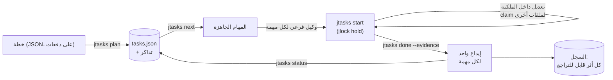

<!-- languages -->
[English](README.md) · [Português (Brasil)](README.pt-BR.md) · [Español](README.es.md) · [Français](README.fr.md) · [Deutsch](README.de.md) · [Italiano](README.it.md) · [简体中文](README.zh-CN.md) · [日本語](README.ja.md) · [Русский](README.ru.md) · [العربية](README.ar.md) · [हिन्दी](README.hi.md)

<div dir="rtl">

# jtasks

**يحوّل jtasks الخطة إلى قائمة مهام ينفّذها وكلاء البرمجة بالذكاء الاصطناعي بالتوازي، في نفس الـ checkout، دون
أن يعرقل أحدهم الآخر، بإيداع (commit) واحد لكل مهمة، مع إمكانية التراجع عن كل شيء.**

## لماذا وُجد jtasks

يستطيع وكلاء البرمجة بالذكاء الاصطناعي العمل بالتوازي، لكن الهدف الطويل ("ابنِ تسجيل الدخول"، "انقل المحلّل")
يتعثّر بطرق مألوفة. يحتفظ النموذج بقائمة المهام في ذاكرته أو في ملف Markdown يعدّله يدويًا، فتنحرف القائمة عن
الواقع: تُعلَّم مهمة على أنها منجزة وهي ليست كذلك، ويأخذ وكيلان فرعيان المهمة نفسها، وتُنسى تبعية. والوكلاء الذين
يعملون في الوقت نفسه يعدّلون الملف نفسه فيكتب أحدهم فوق عمل الآخر. والإيداعات تخلط عمل عدة مهام، فلا يمكن عكس مهمة
واحدة وحدها. وحين تموت جلسة، لا أحد يعرف أي مهمة كانت في منتصفها.

ينقل jtasks كل ذلك من النموذج إلى أداة. تُتحقَّق الخطة مرة واحدة؛ وتعيش القائمة في ملف JSON لا تكتبه إلا
الأداة؛ وتعلن كل مهمة الملفات التي تملكها، وتبقى تلك الملفات مقفلة ما دامت المهمة قيد التنفيذ.

## المشكلة بدقة

- **ما الذي يمكن تشغيله الآن.** تكون المهمة جاهزة حين تُنجَز تبعياتها وتكون ملفاتها حرة. ولا يجوز لمهمتين لا تبعية
  بينهما أن تتشاركا ملفًا: ترفض الأداة خطة كهذه وتذكر أي المهام وأي ملف.
- **من يغيّر ماذا.** ما دامت المهمة قيد التنفيذ، تُحجز ملفاتها كأقفال في
  [jlock](https://github.com/rodrigojager/jlock)، وهي أداة أقفال على مستوى الجهاز كله. والمهمة الأخرى التي تحتاج
  أحدها تنتظر في الطابور (`claim`) أو تعمل شيئًا آخر؛ ويُرفض كل انتظار من شأنه أن يغلق دورة.
- **أدلة لا وعود.** تُختم المهمة بـ `done` مع دليلها؛ فتتحقق الأداة من أن ملفاتها وحدها هي التي تغيّرت وتصنع
  الإيداع (`T04: العنوان`). إيداع واحد لكل مهمة: عكس مهمة يعني عكس إيداع واحد.
- **الاستئناف.** موضع التشغيل تحدده حالة القائمة لا ذاكرة النموذج: يعرض `jtasks resume` في أي نافذة ما أُنجز وما
  يعمل وما ينتظر، ويُرجع مهام الوكيل الذي مات.
- **التراجع.** الفروع والإيداعات والمجلدات والأسطر في `.git/info/exclude`: كل أثر تتركه الأداة مسجّل في السجل مع
  طريقة التراجع عنه (`jtasks ledger`، `jtasks undo`).

## كيف يعمل

<div dir="ltr">



</div>

للأداة ثلاثة أشكال بالأوامر نفسها: تعديل (mod) لـ Claude Code (أداة `jtasks`، ولوحة فيها قائمة التحقق وشريط التقدم،
و`/jtasks`)، وإضافة (plugin) لـ OpenCode (الأداة نفسها وقسم في الشريط الجانبي)، وواجهة سطر أوامر (CLI) هي `jtasks`
للطرفية أو لأي وكيل آخر. وما دام تشغيلٌ مرتبطًا بجلسة، يضع التعديل والإضافة البروتوكول في موجّه النموذج:
`jtasks next`، ووكيل فرعي لكل مهمة جاهزة، و`jtasks status` حتى لا يبقى شيء. ويرفض حارسٌ أي تعديل خارج ملكية المهمة
وأوامر git من الوكلاء الفرعيين.

## التثبيت

تحتاج إلى [bun](https://bun.sh) و`git`. من نسخة مستنسخة من هذا المستودع:

<div dir="ltr">

```
bun install
bun link            # a `jtasks` command (or run bun cli/jtasks.ts <action>)
jtasks doctor        # is this machine ready?
jtasks doctor --fix --yes   # installs what is missing: jlock, the OpenCode agents, the skills
```

</div>

الأمر `jtasks doctor --fix` دون `--yes` يسرد فقط ما سيفعله. وكل ما يثبّته يدخل السجل، فيزيله `jtasks undo`. ثم، بحسب
وكيلك:

- **Claude Code:** `claude --plugin-dir <jtasks>/claude` (التعديل؛ انظر
  [`claude/README.md`](claude/README.md)).
- **OpenCode:** أضف `<jtasks>/opencode` إلى `plugins` في `opencode.json` (انظر
  [`opencode/README.md`](opencode/README.md)).
- **Codex أو الطرفية:** المهارات في [`skills/`](skills/README.md) تعلّم الوكيل الأوامر.

## خمس دقائق

خطة من ثلاث مهام: اثنتان يمكن أن تعملا معًا، وثالثة تجمعهما.

<div dir="ltr">

```json
{
  "objective": "A sum, its docs, and the entry point",
  "tasks": [
    { "id": "T01", "title": "Sum", "files": ["src/sum.ts"], "acceptance": ["sum.ts exports sum"] },
    { "id": "T02", "title": "Docs", "files": ["docs/sum.md"] },
    { "id": "T03", "title": "Entry", "dependsOn": ["T01", "T02"], "files": ["src/index.ts"] }
  ]
}
```

</div>

<div dir="ltr">

<!-- jtasks-example -->
```text
$ jtasks plan @plan.json
أُنشئ التشغيل a-sum-its-docs-and-the-e-261024-ibmx، المهام: 3، branch gt/a-sum-its-docs-and-the-e-261024-ibmx
التذاكر: 3 في ~/project/.scratch/jtasks/runs/a-sum-its-docs-and-the-e-261024-ibmx/tickets
الخطوة التالية: jtasks next

$ jtasks next
الجاهزة (2) في a-sum-its-docs-and-the-e-261024-ibmx؛ يمكن تشغيلها بالتوازي:
T01 · Sum · الملف التعريفي implement · الملكية: src/sum.ts
  المعايير: sum.ts exports sum
  ticket: ~/project/.scratch/jtasks/runs/a-sum-its-docs-and-the-e-261024-ibmx/tickets/01-sum.md
T02 · Docs · الملف التعريفي implement · الملكية: docs/sum.md
  ticket: ~/project/.scratch/jtasks/runs/a-sum-its-docs-and-the-e-261024-ibmx/tickets/02-docs.md
محجوبة: T03 ⛔ T01, T02

$ jtasks start T01
T01 قيد التنفيذ (المحاولة 1): قُفلت الملكية في jlock (المفاتيح: 1، المالك gt:a-sum-its-docs-and-the-e-261024-ibmx/T01)
ticket: ~/project/.scratch/jtasks/runs/a-sum-its-docs-and-the-e-261024-ibmx/tickets/01-sum.md
ملف آخر: jtasks claim T01 <file>؛ في النهاية: jtasks done T01 --evidence "…" (أو jtasks fail T01 --error "…")

$ echo "export const sum = (a: number, b: number) => a + b" > src/sum.ts
$ jtasks done T01 --evidence "sum.ts exports sum"
أُنجزت T01: commit 1a4d287 (T01: Sum)؛ أُرجعت الملكية
المنجزة 1/3 (33%) · المتبقي: 2

$ jtasks status
المنجزة 1/3 (33%) · المتبقي: 2
الجاهزة: T02
محجوبة: T03 ⛔ T02
الأقفال النشطة: لا شيء
```

</div>

أعاد `jtasks next` المهمتين T01 و T02 معًا: ملفاتهما لا تتداخل، فيمكن لوكيلين أخذهما في الوقت نفسه. وتنتظر T03
كلتيهما. وصنع `done` الإيداع `T01: Sum` بالملف `src/sum.ts` وحده.

## مع Claude Code

بعد تحميل التعديل، اطلب من Claude أن يخطّط بالمهارة `to-tickets` (تأتي مع التعديل): فهي تقسّم العمل إلى مهام، وتطلب
موافقتك عليها، وتسلّم الخطة إلى الأداة على دفعات. ثم ابدأ هدفًا:

<div dir="ltr">

```
/goal every task of run <run> is done or skipped (jtasks status says nothing is left)
```

</div>

يستدعي Claude الأمر `jtasks next`، ويفتح وكيلًا فرعيًا لكل مهمة جاهزة في الرد نفسه (كلٌّ على نموذج ملفه التعريفي)،
ويستدعي `jtasks status` حتى لا يبقى شيء. ويفتح `/jtasks` اللوحة أو يغلقها.

## مع OpenCode

مع الإضافة، الأمر نفسه: `to-tickets` للتخطيط، ثم هدف. يحصل استدعاء `subagent` لكل مهمة على وكيل ملفها التعريفي
(`implement`، `implement-deep`، `review`، التي يثبّتها `jtasks doctor --fix --yes`، أو أي وكيل تسمّيه في الخطة).
ويعرض الشريط الجانبي قائمة التحقق وشريط التقدم.

## من الطرفية أو Codex

دون تعديل أو إضافة، تكون المهارة `jtasks` هي البروتوكول: يشغّل الوكيل `jtasks next`، وينجز كل مهمة داخل ملكيتها
(`jtasks start`، `jtasks claim`، `jtasks done`)، ويكرّر حتى يقول `jtasks status` إنه لم يبق شيء. ويمكن لشخص أن يفعل
الشيء نفسه يدويًا.

## الضمانات والحدود

| يضمن jtasks | ما لا يفعله |
|---|---|
| الأداة وحدها تكتب القائمة؛ وكل تغيير متحقَّق منه وذرّي | منع برنامج يتجاهل jlock من تعديل ملف |
| ملفات المهمة مقفلة في jlock ما دامت قيد التنفيذ؛ والمهام المتوازية لا تتشارك ملفًا أبدًا | قفل أجزاء من ملف: الملكية بالملف والمجلد |
| إيداع واحد لكل مهمة، بملفات تلك المهمة وحدها | دمج عمل أُنجز خارج الأداة |
| كل أثر في السجل ويمكن التراجع عنه | التراجع عمّا لم ينشئه |
| تعود أقفال الوكيل أو النافذة الميتة (فورًا مع OpenCode، وإلا عند انتهاء المهلة) | العمل عبر عدة أجهزة (jlock جهاز واحد) |

Windows أولًا: جرى التحقق من jlock و jtasks على Windows؛ ويتبع Linux و macOS خطة jlock نفسها.

## الإعداد

| المتغير | الافتراضي | الاستخدام |
|---|---|---|
| `JTASKS_HOME` | `~/.jtasks` | السجل العام والتشغيلات المؤرشفة |
| `JTASKS_LANG` | لغة النظام | لغة الإجابات (`--lang` في الأمر له الأولوية) |
| `JTASKS_RUN` | غير مضبوط | التشغيل الذي تعمل عليه واجهة CLI، بدلًا من `--run` |
| `JLOCK_BIN` | `jlock` | الملف التنفيذي لـ jlock |

إحدى عشرة لغة، هي نفسها لغات jlock: English، Português (Brasil)، Español، Français، Deutsch، Italiano، 简体中文، 日本語،
Русский، العربية، हिन्दी. كل الأوامر في [`docs/USAGE.md`](docs/USAGE.md)؛ والتصميم (بالبرتغالية) في
[`docs/PLAN.md`](docs/PLAN.md)، وما جاء مختلفًا في [`docs/DEVIATIONS.md`](docs/DEVIATIONS.md).

## المساهمة

البلاغات (issues) وطلبات الدمج (pull requests) مرحّب بها؛ انظر [`CONTRIBUTING.md`](CONTRIBUTING.md). ومراجعات
النصوص مرحّب بها بأي لغة، والإنجليزية منها، ولا تحتاج إلى TypeScript: النصوص ملفات JSON في `locales/`.

## المؤلف

Rodrigo Jäger — GitHub <https://github.com/rodrigojager> · LinkedIn <https://www.linkedin.com/in/rodrigojager>

## الترخيص

MIT، انظر [`LICENSE`](LICENSE).

</div>

هذه الترجمة بانتظار مراجعة متحدث أصلي باللغة؛ والتصحيحات مرحّب بها ([كيف تساهم](CONTRIBUTING.md)).
