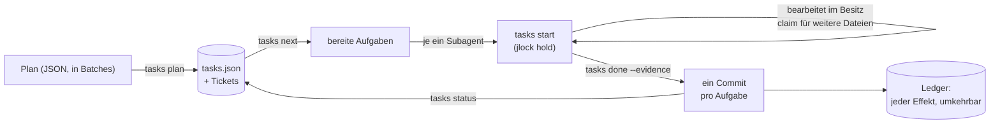

<!-- languages -->
[English](README.md) · [Português (Brasil)](README.pt-BR.md) · [Español](README.es.md) · [Français](README.fr.md) · [Deutsch](README.de.md) · [Italiano](README.it.md) · [简体中文](README.zh-CN.md) · [日本語](README.ja.md) · [Русский](README.ru.md) · [العربية](README.ar.md) · [हिन्दी](README.hi.md)

# jtasks

**jtasks macht aus einem Plan eine Aufgabenliste, die KI-Programmieragenten parallel abarbeiten, im selben
Checkout, ohne sich gegenseitig in die Quere zu kommen, mit einem Commit pro Aufgabe und alles rückgängig
machbar.**

## Warum es jtasks gibt

KI-Programmieragenten können parallel arbeiten, aber ein langes Ziel („bau den Login“, „portiere den Parser“) geht
auf bekannte Weise schief. Das Modell hält die Aufgabenliste im Kopf oder in einer Markdown-Datei, die es von Hand
bearbeitet, und die Liste driftet ab: Eine Aufgabe wird als erledigt markiert, obwohl sie es nicht ist, zwei
Subagenten nehmen dieselbe Aufgabe, eine Abhängigkeit wird vergessen. Gleichzeitig laufende Agenten bearbeiten
dieselbe Datei, und einer überschreibt den anderen. Commits vermischen die Arbeit mehrerer Aufgaben, sodass sich
keine einzeln zurücknehmen lässt. Und wenn eine Sitzung stirbt, weiß niemand, welche Aufgabe halb fertig war.

jtasks nimmt all das aus dem Modell heraus und gibt es einem Tool. Der Plan wird einmal geprüft; die Liste
liegt in einer JSON-Datei, die nur das Tool schreibt; jede Aufgabe gibt die Dateien an, die ihr gehören (ihr
Besitz), und diese Dateien sind gesperrt, solange sie läuft.

## Das Problem, genau

- **Was jetzt laufen kann.** Eine Aufgabe ist bereit, wenn ihre Abhängigkeiten erledigt und ihre Dateien frei sind.
  Zwei Aufgaben ohne Abhängigkeit zwischen sich dürfen keine Datei teilen: Das Tool lehnt einen solchen Plan ab und
  nennt die Aufgaben und die Datei.
- **Wer was ändert.** Solange eine Aufgabe läuft, werden ihre Dateien als Sperren in
  [jlock](https://github.com/rodrigojager/jlock) gehalten, einem rechnerweiten Sperr-Tool. Eine andere Aufgabe, die
  eine davon braucht, wartet in der Warteschlange (`claim`) oder macht etwas anderes; ein Warten, das einen Zyklus
  schließen würde, wird abgelehnt.
- **Nachweise statt Versprechen.** Eine Aufgabe wird mit `done` und ihrem Nachweis abgeschlossen; das Tool prüft,
  dass sich nur ihre Dateien geändert haben, und macht den Commit (`T04: Titel`). Ein Commit pro Aufgabe: Eine
  Aufgabe zurücknehmen heißt einen Commit zurücknehmen.
- **Fortsetzen.** Wo der Lauf steht, ist der Zustand der Liste, nicht das Gedächtnis des Modells: `tasks resume`
  zeigt in jedem Fenster, was erledigt ist, was läuft und was wartet, und gibt die Aufgaben eines gestorbenen
  Agenten zurück.
- **Rückgängig machen.** Branches, Commits, Ordner, Zeilen in `.git/info/exclude`: Jeder Effekt, den das Tool
  hinterlässt, steht in einem Ledger, samt der Art, ihn rückgängig zu machen (`tasks ledger`, `tasks undo`).

## Wie es funktioniert



Das Tool gibt es in drei Formen mit denselben Befehlen: ein Mod für Claude Code (ein Tool `tasks`, ein Bereich mit
der Checkliste und einem Fortschrittsbalken, `/jtasks`), ein Plugin für OpenCode (dasselbe Tool und ein Abschnitt
in der Seitenleiste) und ein CLI, `tasks`, für ein Terminal oder jeden anderen Agenten. Solange ein Lauf an eine
Sitzung gebunden ist, legen Mod und Plugin das Protokoll in den Prompt des Modells: `tasks next`, ein Subagent pro
bereiter Aufgabe, `tasks status`, bis nichts mehr offen ist. Ein Wächter lehnt Änderungen außerhalb des Besitzes
der Aufgabe und git-Befehle von Subagenten ab.

## Installation

Du brauchst [bun](https://bun.sh) und `git`. Aus einem Klon dieses Repositorys:

```
bun install
bun link            # ein Befehl `tasks` (oder führe bun cli/tasks.ts <aktion> aus)
tasks doctor        # ist dieser Rechner bereit?
tasks doctor --fix --yes   # installiert, was fehlt: jlock, die OpenCode-Agenten, die Skills
```

`tasks doctor --fix` ohne `--yes` listet nur auf, was es tun würde. Alles, was es installiert, kommt ins Ledger,
sodass `tasks undo` es wieder entfernt. Danach, für deinen Agenten:

- **Claude Code:** `claude --plugin-dir <jtasks>/claude` (der Mod; siehe
  [`claude/README.md`](claude/README.md)).
- **OpenCode:** füge `<jtasks>/opencode` zu `plugins` in `opencode.json` hinzu (siehe
  [`opencode/README.md`](opencode/README.md)).
- **Codex oder ein Terminal:** Die Skills in [`skills/`](skills/README.md) bringen dem Agenten die Befehle bei.

## Fünf Minuten

Ein Plan mit drei Aufgaben: zwei, die zusammen laufen können, und eine, die sie zusammenführt.

```json
{
  "objective": "A sum, its docs, and the entry point",
  "tasks": [
    { "id": "T01", "title": "Sum", "files": ["src/sum.ts"], "acceptance": ["sum.ts exports sum"] },
    { "id": "T02", "title": "Docs", "files": ["docs/sum.md"] },
    { "id": "T03", "title": "Entry", "dependsOn": ["T01", "T02"], "files": ["src/index.ts"] }
  ]
}
```

<!-- jtasks-example -->
```text
$ tasks plan @plan.json
Lauf a-sum-its-docs-and-the-e-261024-covw erstellt: 3 Aufgabe(n), branch gt/a-sum-its-docs-and-the-e-261024-covw
Tickets: 3 in ~/project/.scratch/jtasks/runs/a-sum-its-docs-and-the-e-261024-covw/tickets
nächster Schritt: tasks next

$ tasks next
bereit (2) in a-sum-its-docs-and-the-e-261024-covw; sie können parallel laufen:
T01 · Sum · Profil implement · Besitz: src/sum.ts
  Kriterien: sum.ts exports sum
  ticket: ~/project/.scratch/jtasks/runs/a-sum-its-docs-and-the-e-261024-covw/tickets/01-sum.md
T02 · Docs · Profil implement · Besitz: docs/sum.md
  ticket: ~/project/.scratch/jtasks/runs/a-sum-its-docs-and-the-e-261024-covw/tickets/02-docs.md
blockiert: T03 ⛔ T01, T02

$ tasks start T01
T01 in Arbeit (Versuch 1): Besitz in jlock gesperrt (1 Schlüssel, Besitzer gt:a-sum-its-docs-and-the-e-261024-covw/T01)
ticket: ~/project/.scratch/jtasks/runs/a-sum-its-docs-and-the-e-261024-covw/tickets/01-sum.md
weitere Datei: tasks claim T01 <datei>; am Ende: tasks done T01 --evidence "…" (oder tasks fail T01 --error "…")

$ echo "export const sum = (a: number, b: number) => a + b" > src/sum.ts
$ tasks done T01 --evidence "sum.ts exports sum"
T01 erledigt: commit 6d0f80e (T01: Sum); Besitz zurückgegeben
erledigt 1/3 (33%) · 2 offen

$ tasks status
erledigt 1/3 (33%) · 2 offen
bereit: T02
blockiert: T03 ⛔ T02
aktive Sperren: keine
```

`tasks next` hat T01 und T02 zusammen geliefert: Ihre Dateien überschneiden sich nicht, also können zwei Agenten
sie gleichzeitig nehmen. T03 wartet auf beide. `done` hat den Commit `T01: Sum` nur mit `src/sum.ts` gemacht.

## Mit Claude Code

Bitte Claude bei geladenem Mod, mit der Skill `to-tickets` zu planen (sie wird mit dem Mod ausgeliefert): Sie
zerlegt die Arbeit in Aufgaben, lässt dich sie freigeben und übergibt den Plan in Batches an das Tool. Starte dann
ein Goal:

```
/goal jede Aufgabe von Lauf <run> ist erledigt oder übersprungen (tasks status meldet, dass nichts offen ist)
```

Claude ruft `tasks next` auf, öffnet in derselben Antwort einen Subagenten pro bereiter Aufgabe (jeden mit dem
Modell seines Profils) und ruft `tasks status` auf, bis nichts mehr offen ist. `/jtasks` öffnet oder schließt den
Bereich.

## Mit OpenCode

Mit dem Plugin genauso: `to-tickets` zum Planen, dann ein Goal. Der `subagent`-Aufruf jeder Aufgabe bekommt den
Agenten ihres Profils (`implement`, `implement-deep`, `review`, installiert von `tasks doctor --fix --yes`, oder
jeden Agenten, den du im Plan nennst). Die Seitenleiste zeigt die Checkliste und den Fortschrittsbalken.

## Aus einem Terminal oder Codex

Ohne Mod oder Plugin ist die Skill `jtasks` das Protokoll: Der Agent führt `tasks next` aus, erledigt jede
Aufgabe innerhalb ihres Besitzes (`tasks start`, `tasks claim`, `tasks done`) und wiederholt das, bis
`tasks status` meldet, dass nichts mehr offen ist. Ein Mensch kann dasselbe von Hand tun.

## Garantien und Grenzen

| jtasks garantiert | Was es nicht tut |
|---|---|
| Nur das Tool schreibt die Liste; jede Änderung wird geprüft und ist atomar | ein Programm, das jlock ignoriert, am Bearbeiten einer Datei hindern |
| Die Dateien einer Aufgabe sind in jlock gesperrt, solange sie läuft; parallele Aufgaben teilen nie eine Datei | Teile einer Datei sperren: Besitz gilt pro Datei und Ordner |
| Ein Commit pro Aufgabe, nur mit den Dateien dieser Aufgabe | außerhalb des Tools erledigte Arbeit mergen |
| Jeder Effekt steht im Ledger und lässt sich rückgängig machen | rückgängig machen, was es nicht erzeugt hat |
| Die Sperren eines gestorbenen Agenten oder Fensters kommen zurück (sofort mit OpenCode, sonst nach Fristablauf) | über mehrere Rechner hinweg arbeiten (jlock gilt für einen Rechner) |

Windows zuerst: jlock und jtasks wurden unter Windows geprüft; Linux und macOS folgen dem Plan von jlock.

## Konfiguration

| Variable | Standard | Zweck |
|---|---|---|
| `JTASKS_HOME` | `~/.jtasks` | das globale Ledger und archivierte Läufe |
| `JTASKS_LANG` | die des Systems | die Sprache der Antworten (`--lang` bei einem Befehl hat Vorrang) |
| `JTASKS_RUN` | nicht gesetzt | der Lauf, an dem das CLI arbeitet, statt `--run` |
| `JLOCK_BIN` | `jlock` | die ausführbare Datei von jlock |

Elf Sprachen, dieselben wie bei jlock: English, Português (Brasil), Español, Français, Deutsch, Italiano, 简体中文,
日本語, Русский, العربية, हिन्दी. Alle Befehle stehen in [`docs/USAGE.md`](docs/USAGE.md); der Entwurf (auf
Portugiesisch) steht in [`docs/PLAN.md`](docs/PLAN.md), und was anders herauskam, in
[`docs/DEVIATIONS.md`](docs/DEVIATIONS.md).

## Mitmachen

Issues und Pull Requests sind willkommen; siehe [`CONTRIBUTING.md`](CONTRIBUTING.md). Korrekturen der Texte sind in
jeder Sprache willkommen, Englisch eingeschlossen, und brauchen kein TypeScript: Die Texte sind JSON-Dateien in
`locales/`.

## Autor

Rodrigo Jäger — GitHub <https://github.com/rodrigojager> · LinkedIn <https://www.linkedin.com/in/rodrigojager>

## Lizenz

MIT, siehe [`LICENSE`](LICENSE).
