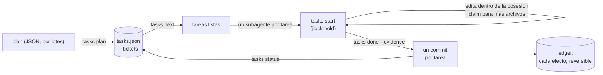

<!-- languages -->
[English](README.md) · [Português (Brasil)](README.pt-BR.md) · [Español](README.es.md) · [Français](README.fr.md) · [Deutsch](README.de.md) · [Italiano](README.it.md) · [简体中文](README.zh-CN.md) · [日本語](README.ja.md) · [Русский](README.ru.md) · [العربية](README.ar.md) · [हिन्दी](README.hi.md)

# jtasks

**jtasks convierte un plan en una lista de tareas que los agentes de IA de programación llevan a cabo en
paralelo, en el mismo checkout, sin pisarse, con un commit por tarea y todo reversible.**

## Por qué existe jtasks

Los agentes de IA de programación pueden trabajar en paralelo, pero un objetivo largo ("haz el login", "porta el
parser") sale mal de maneras conocidas. El modelo guarda la lista de tareas en la cabeza o en un archivo Markdown
que edita a mano, y la lista se aleja de la realidad: una tarea se marca como hecha sin estarlo, dos subagentes
toman la misma tarea, se olvida una dependencia. Agentes que trabajan a la vez editan el mismo archivo y uno
sobrescribe al otro. Los commits mezclan el trabajo de varias tareas, así que ninguna puede revertirse por
separado. Y cuando una sesión muere, nadie sabe qué tarea quedó a medias.

jtasks saca todo eso del modelo y lo lleva a una herramienta. El plan se valida una vez; la lista vive en un
archivo JSON que solo escribe la herramienta; cada tarea declara los archivos que le pertenecen (su posesión), y
esos archivos quedan bloqueados mientras se ejecuta.

## El problema, con precisión

- **Qué puede ejecutarse ahora.** Una tarea está lista cuando sus dependencias están hechas y sus archivos están
  libres. Dos tareas sin dependencia entre ellas no pueden compartir un archivo: la herramienta rechaza un plan así
  y dice qué tareas y qué archivo.
- **Quién cambia qué.** Mientras una tarea se ejecuta, sus archivos se mantienen como bloqueos en
  [jlock](https://github.com/rodrigojager/jlock), una herramienta de bloqueos para toda la máquina. Otra tarea que
  necesite uno de ellos espera en la cola (`claim`) o hace otra cosa; una espera que cerraría un ciclo se rechaza.
- **Pruebas, no promesas.** Una tarea se termina con `done` y su evidencia; la herramienta comprueba que solo
  cambiaron sus archivos y hace el commit (`T04: título`). Un commit por tarea: revertir una tarea es revertir un
  commit.
- **Reanudar.** En qué punto está la ejecución lo dice el estado de la lista, no la memoria del modelo:
  `tasks resume` en cualquier ventana muestra qué está hecho, qué se ejecuta y qué espera, y devuelve las tareas de
  un agente que murió.
- **Deshacer.** Ramas, commits, carpetas, líneas en `.git/info/exclude`: cada efecto que deja la herramienta está
  en un ledger, junto con la forma de deshacerlo (`tasks ledger`, `tasks undo`).

## Cómo funciona



La herramienta tiene tres formas con los mismos comandos: un mod para Claude Code (una herramienta `tasks`, un
panel con la lista de comprobación y una barra de progreso, `/jtasks`), un plugin para OpenCode (la misma
herramienta y una sección en la barra lateral) y un CLI, `tasks`, para una terminal o cualquier otro agente.
Mientras una ejecución está ligada a una sesión, el mod y el plugin ponen el protocolo en el prompt del modelo:
`tasks next`, un subagente por tarea lista, `tasks status` hasta que no quede nada. Una guarda rechaza las
ediciones fuera de la posesión de la tarea y los comandos git de los subagentes.

## Instalación

Necesitas [bun](https://bun.sh) y `git`. Desde un clon de este repositorio:

```
bun install
bun link            # un comando `tasks` (o ejecuta bun cli/tasks.ts <acción>)
tasks doctor        # ¿está lista esta máquina?
tasks doctor --fix --yes   # instala lo que falta: jlock, los agentes de OpenCode, las skills
```

`tasks doctor --fix` sin `--yes` solo enumera lo que haría. Todo lo que instala va al ledger, así que `tasks undo`
lo elimina. Después, para tu agente:

- **Claude Code:** `claude --plugin-dir <jtasks>/claude` (el mod; ver [`claude/README.md`](claude/README.md)).
- **OpenCode:** añade `<jtasks>/opencode` a `plugins` en `opencode.json` (ver
  [`opencode/README.md`](opencode/README.md)).
- **Codex o una terminal:** las skills de [`skills/`](skills/README.md) le enseñan los comandos al agente.

## Cinco minutos

Un plan con tres tareas: dos que pueden ejecutarse juntas y una que las une.

```json
{
  "objective": "A sum, its docs, and the entry point",
  "tasks": [
    { "id": "T01", "title": "Sum", "files": ["src/sum.ts"], "acceptance": ["sum.ts exports sum"] },
    { "id": "T02", "title": "Docs", "files": ["docs/sum.md"] },
    { "id": "T03", "title": "Entry", "dependsOn": ["T01", "T02"], "files": ["src/index.ts"] }
  ]
}
```

<!-- jtasks-example -->
```text
$ tasks plan @plan.json
ejecución a-sum-its-docs-and-the-e-261024-zrqc creada: 3 tarea(s), branch gt/a-sum-its-docs-and-the-e-261024-zrqc
tickets: 3 en ~/project/.scratch/jtasks/runs/a-sum-its-docs-and-the-e-261024-zrqc/tickets
siguiente paso: tasks next

$ tasks next
listas (2) en a-sum-its-docs-and-the-e-261024-zrqc; pueden ejecutarse en paralelo:
T01 · Sum · perfil implement · posesión: src/sum.ts
  criterios: sum.ts exports sum
  ticket: ~/project/.scratch/jtasks/runs/a-sum-its-docs-and-the-e-261024-zrqc/tickets/01-sum.md
T02 · Docs · perfil implement · posesión: docs/sum.md
  ticket: ~/project/.scratch/jtasks/runs/a-sum-its-docs-and-the-e-261024-zrqc/tickets/02-docs.md
bloqueadas: T03 ⛔ T01, T02

$ tasks start T01
T01 en curso (intento 1): posesión bloqueada en jlock (1 clave(s), dueño gt:a-sum-its-docs-and-the-e-261024-zrqc/T01)
ticket: ~/project/.scratch/jtasks/runs/a-sum-its-docs-and-the-e-261024-zrqc/tickets/01-sum.md
otro archivo: tasks claim T01 <archivo>; al final: tasks done T01 --evidence "…" (o tasks fail T01 --error "…")

$ echo "export const sum = (a: number, b: number) => a + b" > src/sum.ts
$ tasks done T01 --evidence "sum.ts exports sum"
T01 hecha: commit 10af042 (T01: Sum); posesión devuelta
hechas 1/3 (33%) · quedan 2

$ tasks status
hechas 1/3 (33%) · quedan 2
listas: T02
bloqueadas: T03 ⛔ T02
bloqueos activos: ninguno
```

`tasks next` devolvió T01 y T02 juntas: sus archivos no se solapan, así que dos agentes pueden tomarlas a la vez.
T03 espera a las dos. `done` hizo el commit `T01: Sum` solo con `src/sum.ts`.

## Con Claude Code

Con el mod cargado, pide a Claude que planifique con la skill `to-tickets` (viene con el mod): divide el trabajo en
tareas, te pide que las apruebes y entrega el plan a la herramienta por lotes. Después, inicia un goal:

```
/goal cada tarea de la ejecución <run> está hecha u omitida (tasks status dice que no queda nada)
```

Claude llama a `tasks next`, abre un subagente por tarea lista en la misma respuesta (cada uno con el modelo de su
perfil) y llama a `tasks status` hasta que no quede nada. `/jtasks` abre o cierra el panel.

## Con OpenCode

Con el plugin, lo mismo: `to-tickets` para planificar y luego un goal. La llamada `subagent` de cada tarea recibe
el agente de su perfil (`implement`, `implement-deep`, `review`, instalados por `tasks doctor --fix --yes`, o
cualquier agente que nombres en el plan). La barra lateral muestra la lista de comprobación y la barra de progreso.

## Desde una terminal o Codex

Sin mod ni plugin, la skill `jtasks` es el protocolo: el agente ejecuta `tasks next`, hace cada tarea dentro de
su posesión (`tasks start`, `tasks claim`, `tasks done`) y repite hasta que `tasks status` diga que no queda nada.
Una persona puede hacer lo mismo a mano.

## Garantías y límites

| jtasks garantiza | Lo que no hace |
|---|---|
| Solo la herramienta escribe la lista; cada cambio se valida y es atómico | impedir que un programa que ignora jlock edite un archivo |
| Los archivos de una tarea están bloqueados en jlock mientras se ejecuta; las tareas en paralelo nunca comparten un archivo | bloquear partes de un archivo: la posesión es por archivo y carpeta |
| Un commit por tarea, solo con los archivos de esa tarea | fusionar trabajo hecho fuera de la herramienta |
| Cada efecto está en el ledger y puede deshacerse | deshacer lo que no creó |
| Los bloqueos de un agente o una ventana que murió vuelven (al instante con OpenCode, al cumplirse el plazo en otro caso) | funcionar entre máquinas (jlock abarca una sola máquina) |

Windows primero: jlock y jtasks se validaron en Windows; Linux y macOS siguen el plan del propio jlock.

## Configuración

| Variable | Por defecto | Uso |
|---|---|---|
| `JTASKS_HOME` | `~/.jtasks` | el ledger global y las ejecuciones archivadas |
| `JTASKS_LANG` | el del sistema | el idioma de las respuestas (`--lang` en un comando tiene prioridad) |
| `JTASKS_RUN` | sin definir | la ejecución sobre la que trabaja el CLI, en lugar de `--run` |
| `JLOCK_BIN` | `jlock` | el ejecutable de jlock |

Once idiomas, los mismos que jlock: English, Português (Brasil), Español, Français, Deutsch, Italiano, 简体中文,
日本語, Русский, العربية, हिन्दी. Todos los comandos están en [`docs/USAGE.md`](docs/USAGE.md); el diseño (en
portugués) está en [`docs/PLAN.md`](docs/PLAN.md), y lo que salió distinto, en
[`docs/DEVIATIONS.md`](docs/DEVIATIONS.md).

## Cómo contribuir

Los issues y pull requests son bienvenidos; ver [`CONTRIBUTING.md`](CONTRIBUTING.md). Las revisiones de los textos
son bienvenidas en cualquier idioma, inglés incluido, y no requieren TypeScript: los textos son archivos JSON en
`locales/`.

## Autor

Rodrigo Jäger — GitHub <https://github.com/rodrigojager> · LinkedIn <https://www.linkedin.com/in/rodrigojager>

## Licencia

MIT, ver [`LICENSE`](LICENSE).
