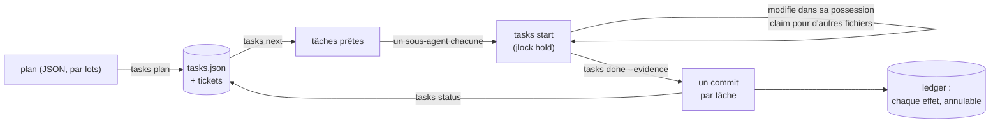

<!-- languages -->
[English](README.md) · [Português (Brasil)](README.pt-BR.md) · [Español](README.es.md) · [Français](README.fr.md) · [Deutsch](README.de.md) · [Italiano](README.it.md) · [简体中文](README.zh-CN.md) · [日本語](README.ja.md) · [Русский](README.ru.md) · [العربية](README.ar.md) · [हिन्दी](README.hi.md)

# jtasks

**jtasks transforme un plan en une liste de tâches que des agents de programmation IA exécutent en parallèle,
dans le même checkout, sans se marcher dessus, avec un commit par tâche et tout annulable.**

## Pourquoi jtasks existe

Les agents de programmation IA savent travailler en parallèle, mais un objectif long (« faire le login », « porter
le parser ») déraille de façons bien connues. Le modèle garde la liste des tâches en tête ou dans un fichier
Markdown qu'il modifie à la main, et la liste dérive : une tâche est marquée terminée alors qu'elle ne l'est pas,
deux sous-agents prennent la même tâche, une dépendance est oubliée. Des agents qui tournent en même temps
modifient le même fichier et l'un écrase l'autre. Les commits mélangent le travail de plusieurs tâches, si bien
qu'aucune ne peut être annulée seule. Et quand une session meurt, personne ne sait quelle tâche est restée à moitié
faite.

jtasks sort tout cela du modèle et le confie à un outil. Le plan est validé une fois ; la liste vit dans un
fichier JSON que seul l'outil écrit ; chaque tâche déclare les fichiers qu'elle possède (sa possession), et ces
fichiers sont verrouillés pendant qu'elle tourne.

## Le problème, précisément

- **Ce qui peut tourner maintenant.** Une tâche est prête quand ses dépendances sont terminées et ses fichiers
  libres. Deux tâches sans dépendance entre elles ne doivent pas partager un fichier : l'outil refuse un tel plan
  et dit quelles tâches et quel fichier.
- **Qui change quoi.** Pendant qu'une tâche tourne, ses fichiers sont tenus comme verrous dans
  [jlock](https://github.com/rodrigojager/jlock), un outil de verrous pour toute la machine. Une autre tâche qui a
  besoin de l'un d'eux attend dans la file d'attente (`claim`) ou fait autre chose ; une attente qui fermerait un
  cycle est refusée.
- **Des preuves, pas des promesses.** Une tâche se termine avec `done` et sa preuve ; l'outil vérifie que seuls ses
  fichiers ont changé et fait le commit (`T04: titre`). Un commit par tâche : annuler une tâche, c'est annuler un
  commit.
- **Reprendre.** Où en est l'exécution, c'est l'état de la liste, pas la mémoire du modèle : `tasks resume`, dans
  n'importe quelle fenêtre, montre ce qui est terminé, ce qui tourne, ce qui attend, et rend les tâches d'un agent
  mort.
- **Annuler.** Branches, commits, dossiers, lignes dans `.git/info/exclude` : chaque effet laissé par l'outil est
  dans un ledger, avec la façon de l'annuler (`tasks ledger`, `tasks undo`).

## Comment ça marche



L'outil existe sous trois formes, avec les mêmes commandes : un mod pour Claude Code (un outil `tasks`, un panneau
avec la checklist et une barre de progression, `/jtasks`), un plugin pour OpenCode (le même outil et une section
dans la barre latérale) et un CLI, `tasks`, pour un terminal ou n'importe quel autre agent. Tant qu'une exécution
est liée à une session, le mod et le plugin placent le protocole dans le prompt du modèle : `tasks next`, un
sous-agent par tâche prête, `tasks status` jusqu'à ce qu'il ne reste rien. Une garde refuse les modifications hors
de la possession de la tâche et les commandes git lancées par des sous-agents.

## Installation

Il vous faut [bun](https://bun.sh) et `git`. Depuis un clone de ce dépôt :

```
bun install
bun link            # une commande `tasks` (ou lancez bun cli/tasks.ts <action>)
tasks doctor        # cette machine est-elle prête ?
tasks doctor --fix --yes   # installe ce qui manque : jlock, les agents OpenCode, les skills
```

`tasks doctor --fix` sans `--yes` se contente de lister ce qu'il ferait. Tout ce qu'il installe va dans le ledger,
donc `tasks undo` le retire. Ensuite, pour votre agent :

- **Claude Code :** `claude --plugin-dir <jtasks>/claude` (le mod ; voir
  [`claude/README.md`](claude/README.md)).
- **OpenCode :** ajoutez `<jtasks>/opencode` à `plugins` dans `opencode.json` (voir
  [`opencode/README.md`](opencode/README.md)).
- **Codex ou un terminal :** les skills de [`skills/`](skills/README.md) apprennent les commandes à l'agent.

## Cinq minutes

Un plan de trois tâches : deux qui peuvent tourner ensemble et une qui les réunit.

```json
{
  "objective": "A sum, its docs, and the entry point",
  "tasks": [
    { "id": "T01", "title": "Sum", "files": ["src/sum.ts"], "acceptance": ["sum.ts exports sum"] },
    { "id": "T02", "title": "Docs", "files": ["docs/sum.md"] },
    { "id": "T03", "title": "Entry", "dependsOn": ["T01", "T02"], "files": ["src/index.ts"] }
  ]
}
```

<!-- jtasks-example -->
```text
$ tasks plan @plan.json
exécution a-sum-its-docs-and-the-e-261024-qhve créée: 3 tâche(s), branch gt/a-sum-its-docs-and-the-e-261024-qhve
tickets: 3 dans ~/project/.scratch/jtasks/runs/a-sum-its-docs-and-the-e-261024-qhve/tickets
étape suivante: tasks next

$ tasks next
prêtes (2) dans a-sum-its-docs-and-the-e-261024-qhve; elles peuvent tourner en parallèle:
T01 · Sum · profil implement · possession: src/sum.ts
  critères: sum.ts exports sum
  ticket: ~/project/.scratch/jtasks/runs/a-sum-its-docs-and-the-e-261024-qhve/tickets/01-sum.md
T02 · Docs · profil implement · possession: docs/sum.md
  ticket: ~/project/.scratch/jtasks/runs/a-sum-its-docs-and-the-e-261024-qhve/tickets/02-docs.md
bloquées: T03 ⛔ T01, T02

$ tasks start T01
T01 en cours (tentative 1): possession verrouillée dans jlock (1 clé(s), propriétaire gt:a-sum-its-docs-and-the-e-261024-qhve/T01)
ticket: ~/project/.scratch/jtasks/runs/a-sum-its-docs-and-the-e-261024-qhve/tickets/01-sum.md
un autre fichier: tasks claim T01 <fichier>; à la fin: tasks done T01 --evidence "…" (ou tasks fail T01 --error "…")

$ echo "export const sum = (a: number, b: number) => a + b" > src/sum.ts
$ tasks done T01 --evidence "sum.ts exports sum"
T01 terminée: commit e343bfc (T01: Sum); possession rendue
terminées 1/3 (33%) · 2 restantes

$ tasks status
terminées 1/3 (33%) · 2 restantes
prêtes: T02
bloquées: T03 ⛔ T02
verrous actifs: aucun
```

`tasks next` a renvoyé T01 et T02 ensemble : leurs fichiers ne se recouvrent pas, donc deux agents peuvent les
prendre en même temps. T03 attend les deux. `done` a fait le commit `T01: Sum` avec seulement `src/sum.ts`.

## Avec Claude Code

Une fois le mod chargé, demandez à Claude de planifier avec la skill `to-tickets` (elle est fournie avec le mod) :
elle découpe le travail en tâches, vous demande de les approuver et transmet le plan à l'outil par lots. Ensuite,
lancez un goal :

```
/goal chaque tâche de l'exécution <run> est terminée ou ignorée (tasks status dit qu'il ne reste rien)
```

Claude appelle `tasks next`, ouvre un sous-agent par tâche prête dans la même réponse (chacun sur le modèle de son
profil) et appelle `tasks status` jusqu'à ce qu'il ne reste rien. `/jtasks` ouvre ou ferme le panneau.

## Avec OpenCode

Avec le plugin, c'est pareil : `to-tickets` pour planifier, puis un goal. L'appel `subagent` de chaque tâche reçoit
l'agent de son profil (`implement`, `implement-deep`, `review`, installés par `tasks doctor --fix --yes`, ou
n'importe quel agent que vous nommez dans le plan). La barre latérale affiche la checklist et la barre de
progression.

## Depuis un terminal ou Codex

Sans mod ni plugin, la skill `jtasks` est le protocole : l'agent lance `tasks next`, fait chaque tâche dans sa
possession (`tasks start`, `tasks claim`, `tasks done`) et recommence jusqu'à ce que `tasks status` dise qu'il ne
reste rien. Une personne peut faire de même à la main.

## Garanties et limites

| jtasks garantit | Ce qu'il ne fait pas |
|---|---|
| Seul l'outil écrit la liste ; chaque changement est validé et atomique | empêcher un programme qui ignore jlock de modifier un fichier |
| Les fichiers d'une tâche sont verrouillés dans jlock pendant qu'elle tourne ; des tâches parallèles ne partagent jamais un fichier | verrouiller des parties d'un fichier : la possession se fait par fichier et par dossier |
| Un commit par tâche, avec seulement les fichiers de cette tâche | fusionner du travail fait hors de l'outil |
| Chaque effet est dans le ledger et peut être annulé | annuler ce qu'il n'a pas créé |
| Les verrous d'un agent ou d'une fenêtre morte reviennent (tout de suite avec OpenCode, à l'échéance sinon) | fonctionner entre plusieurs machines (jlock couvre une seule machine) |

Windows d'abord : jlock et jtasks ont été validés sous Windows ; Linux et macOS suivent le plan de jlock.

## Configuration

| Variable | Par défaut | Usage |
|---|---|---|
| `JTASKS_HOME` | `~/.jtasks` | le ledger global et les exécutions archivées |
| `JTASKS_LANG` | celle du système | la langue des réponses (`--lang` sur une commande l'emporte) |
| `JTASKS_RUN` | non définie | l'exécution sur laquelle travaille le CLI, au lieu de `--run` |
| `JLOCK_BIN` | `jlock` | l'exécutable de jlock |

Onze langues, les mêmes que jlock : English, Português (Brasil), Español, Français, Deutsch, Italiano, 简体中文,
日本語, Русский, العربية, हिन्दी. Toutes les commandes sont dans [`docs/USAGE.md`](docs/USAGE.md) ; la conception
(en portugais) est dans [`docs/PLAN.md`](docs/PLAN.md), et ce qui a été fait autrement, dans
[`docs/DEVIATIONS.md`](docs/DEVIATIONS.md).

## Contribuer

Les issues et pull requests sont les bienvenues ; voir [`CONTRIBUTING.md`](CONTRIBUTING.md). Les relectures des
textes sont bienvenues dans toutes les langues, anglais compris, et ne demandent pas de TypeScript : les textes
sont des fichiers JSON dans `locales/`.

## Auteur

Rodrigo Jäger — GitHub <https://github.com/rodrigojager> · LinkedIn <https://www.linkedin.com/in/rodrigojager>

## Licence

MIT, voir [`LICENSE`](LICENSE).
