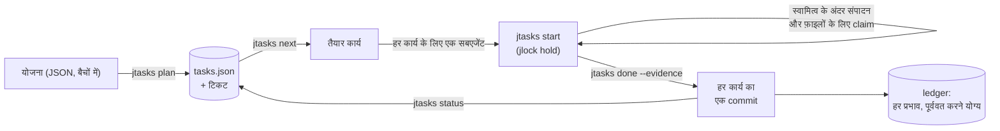

<!-- languages -->
[English](README.md) · [Português (Brasil)](README.pt-BR.md) · [Español](README.es.md) · [Français](README.fr.md) · [Deutsch](README.de.md) · [Italiano](README.it.md) · [简体中文](README.zh-CN.md) · [日本語](README.ja.md) · [Русский](README.ru.md) · [العربية](README.ar.md) · [हिन्दी](README.hi.md)

# jtasks

**jtasks एक योजना को कार्यों की सूची में बदलता है, जिसे AI कोडिंग एजेंट एक ही checkout में समानांतर रूप से पूरा करते हैं, एक-दूसरे के काम में दख़ल दिए बिना, हर कार्य का एक commit, और सब कुछ पूर्ववत किया जा सकता है।**

## jtasks क्यों है

AI कोडिंग एजेंट समानांतर काम कर सकते हैं, पर कोई लंबा लक्ष्य ("लॉगिन बनाओ", "पार्सर पोर्ट करो") जाने-पहचाने तरीकों से बिगड़ जाता है। मॉडल कार्यों की सूची अपने दिमाग़ में रखता है या किसी Markdown फ़ाइल में जिसे वह हाथ से संपादित करता है, और सूची धीरे-धीरे भटक जाती है: जो कार्य पूरा नहीं हुआ उसे पूरा मान लिया जाता है, दो सबएजेंट एक ही कार्य उठा लेते हैं, कोई निर्भरता भूल जाती है। एक साथ चल रहे एजेंट एक ही फ़ाइल संपादित करते हैं और एक दूसरे का काम मिटा देता है। commit में कई कार्यों का काम मिल जाता है, इसलिए किसी एक को अकेले revert नहीं किया जा सकता। और जब कोई सत्र मर जाता है, तो किसी को नहीं पता कि कौन सा कार्य आधा हुआ था।

jtasks यह सब मॉडल से निकालकर एक टूल में ले जाता है। योजना एक बार जाँची जाती है; सूची एक JSON फ़ाइल में रहती है जिसे केवल टूल लिखता है; हर कार्य उन फ़ाइलों की घोषणा करता है जो उसकी हैं, और कार्य चलने के दौरान वे फ़ाइलें लॉक रहती हैं।

## समस्या, ठीक-ठीक

- **अभी क्या चल सकता है।** कोई कार्य तब तैयार होता है जब उसकी निर्भरताएँ पूरी हो चुकी हों और उसकी फ़ाइलें मुक्त हों। जिन दो कार्यों के बीच कोई निर्भरता नहीं है, वे कोई फ़ाइल साझा नहीं कर सकते: टूल ऐसी योजना अस्वीकार करता है और बताता है कि कौन से कार्य और कौन सी फ़ाइल।कई कार्य जिन रजिस्ट्री फ़ाइलों को छूते हैं, वे योजना के `shared` में जाती हैं: जब दो समानांतर कार्य उनमें से किसी को छूते हैं तो टूल चेतावनी देता है, और `"sharedPolicy": "serialize"` उन्हें अलग रखता है।
- **कौन क्या बदलता है।** कार्य चलने के दौरान उसकी फ़ाइलें [jlock](https://github.com/rodrigojager/jlock) में लॉक के रूप में रखी जाती हैं, जो पूरी मशीन पर लागू लॉक टूल है। जिस दूसरे कार्य को उनमें से कोई फ़ाइल चाहिए, वह कतार में प्रतीक्षा करता है (`claim`) या कुछ और करता है; जो प्रतीक्षा एक चक्र बना दे, उसे अस्वीकार कर दिया जाता है। अस्वीकृत कार्य `jtasks yield` से पीछे हटता है: केवल विवादित फ़ाइलें लौटाता है, उसके संपादन एक patch में सहेजे जाते हैं जो उन्हीं के साथ लौटता है, और काम जारी रखता है।
- **कार्य और क्या इस्तेमाल करता है।** फ़ाइलों के अलावा कार्य यह घोषित कर सकता है कि वह क्या इस्तेमाल करता है (`"uses": ["desktop"]`, `"clipboard"`, `"port:8080"`…): ये jlock संसाधन हैं जो उसके चलते समय लॉक रहते हैं, ताकि मशीन पर किसी भी रन के जिन कार्यों को वही चीज़ चाहिए वे बारी-बारी से चलें। `"exclusive": "project"` कार्य को उसकी रिपॉज़िटरी में अकेले चलाता है; `"exclusive": "machine"` मशीन के सभी jtasks कार्यों का इंतज़ार करता है और किसी नए को शुरू नहीं होने देता (बेंचमार्क, समय मापने वाले टेस्ट)। दोनों में से कोई भी दूसरे प्रोजेक्ट के लॉक नहीं रोकता।
- **वादे नहीं, सबूत।** कार्य `done` और उसके सबूत के साथ पूरा होता है; टूल जाँचता है कि केवल उसकी फ़ाइलें बदलीं और commit बनाता है (`T04: शीर्षक`)। हर कार्य का एक commit: किसी कार्य को revert करना एक commit को revert करना है।
- **फिर से शुरू करना।** रन कहाँ तक पहुँचा, यह सूची की स्थिति बताती है, मॉडल की याददाश्त नहीं: किसी भी विंडो में `jtasks resume` दिखाता है कि क्या पूरा हुआ, क्या चल रहा है, क्या प्रतीक्षा में है, और मर चुके एजेंट के कार्य वापस कतार में लौटा देता है।
- **पूर्ववत करना।** ब्रांच, commit, फ़ोल्डर, `.git/info/exclude` की पंक्तियाँ: टूल जो भी प्रभाव छोड़ता है, वह ledger में उसे पूर्ववत करने के तरीके के साथ दर्ज होता है (`jtasks ledger`, `jtasks undo`)।

## यह कैसे काम करता है



टूल के तीन रूप हैं, सभी में वही कमांड: Claude Code के लिए एक mod (एक `jtasks` टूल, चेकलिस्ट और प्रगति पट्टी वाला एक पैन, `/jtasks`), OpenCode के लिए एक प्लगइन (वही टूल और साइडबार में एक खंड), और एक CLI, `jtasks`, टर्मिनल या किसी भी दूसरे एजेंट के लिए। जब कोई रन किसी सत्र से बँधा होता है, mod और प्लगइन मॉडल के प्रॉम्प्ट में प्रोटोकॉल डालते हैं: `jtasks next`, हर तैयार कार्य के लिए एक सबएजेंट, और `jtasks status` जब तक कुछ शेष न रहे। एक गार्ड कार्य के स्वामित्व के बाहर संपादन और सबएजेंट की git कमांड को अस्वीकार करता है।

हर टिकट एक ऐसे सब-एजेंट का पूरा ब्रीफ़ है जो नए संदर्भ के साथ शुरू होता है, और हर बात एक ही बार कहता है: क्या बनाना
है, स्वीकृति मानदंड, उसकी अपनी फ़ाइलें, फिर एक `## Context` जो रन के **साझा सारांश** से शुरू होता है (एक Markdown
फ़ाइल जिसे योजनाकार एक बार लिखता है: समस्या, निर्णय, साझा इंटरफ़ेस और परिपाटियाँ; टूल इसे रन के फ़ोल्डर में रखता है
और हर टिकट में शब्दशः कॉपी करता है), उसके बाद केवल वही जो कार्य का अपना है: उसे चाहिए तथ्य, वहीं लिखे हुए, जो फ़ाइलें
पढ़नी हैं, और केवल संदेह होने पर क्या देखना है।

## इंस्टॉल

आपको [bun](https://bun.sh) और `git` चाहिए। इस रिपॉज़िटरी के क्लोन से:

```
git clone https://github.com/rodrigojager/jtasks
cd jtasks
bun install
bun link            # एक `jtasks` कमांड (या bun cli/jtasks.ts <action> चलाएँ)
jtasks doctor        # क्या यह मशीन तैयार है?
jtasks doctor --fix --yes   # जो नहीं है उसे इंस्टॉल करता है: jlock, OpenCode के एजेंट, स्किल
```

**jlock, jtasks के साथ आता है।** jtasks अपने लॉक [jlock](https://github.com/rodrigojager/jlock) में रखता है, और आपको इसे खुद इंस्टॉल नहीं करना पड़ता: CLI, mod या plugin में जिस पहले कमांड को इसकी ज़रूरत होती है, वह इसके न होने पर इसे आधिकारिक इंस्टॉलर से इंस्टॉल करता है (mod और plugin लोड होते ही) और बताता है कि कहाँ। `jtasks undo` इसे हटाता है; `JTASKS_NO_JLOCK_INSTALL=1` के साथ jlock आपके ज़िम्मे रहता है।

`--yes` के बिना `jtasks doctor --fix` केवल यह सूची दिखाता है कि वह क्या करेगा। वह जो कुछ इंस्टॉल करता है, सब ledger में जाता है, इसलिए `jtasks undo` उसे हटा देता है। फिर, अपने एजेंट के लिए:

- **Claude Code:** `/plugin install jtasks --marketplace rodrigojager/jtasks` (mod; देखें [`claude/README.md`](claude/README.md))।
- **OpenCode:** `opencode.json` में `plugins` में `<jtasks>/opencode` जोड़ें (देखें [`opencode/README.md`](opencode/README.md))।
- **Codex या टर्मिनल:** [`skills/`](skills/README.md) की स्किल एजेंट को कमांड सिखाती हैं।

## पाँच मिनट में

तीन कार्यों वाली एक योजना: दो जो साथ चल सकते हैं और एक जो उन्हें जोड़ता है।

```json
{
  "objective": "A sum, its docs, and the entry point",
  "tasks": [
    { "id": "T01", "title": "Sum", "files": ["src/sum.ts"], "acceptance": ["sum.ts exports sum"] },
    { "id": "T02", "title": "Docs", "files": ["docs/sum.md"] },
    { "id": "T03", "title": "Entry", "dependsOn": ["T01", "T02"], "files": ["src/index.ts"] }
  ]
}
```

<!-- jtasks-example -->
```text
$ jtasks plan @plan.json
रन a-sum-its-docs-and-the-e-261024-1k5o बनाया गया: 3 कार्य, branch gt/a-sum-its-docs-and-the-e-261024-1k5o
टिकट: ~/project/.scratch/jtasks/runs/a-sum-its-docs-and-the-e-261024-1k5o/tickets में 3
अगला कदम: jtasks next

$ jtasks next
a-sum-its-docs-and-the-e-261024-1k5o में तैयार (2); ये समानांतर चल सकते हैं:
T01 · Sum · प्रोफ़ाइल execute · स्वामित्व: src/sum.ts
  मानदंड: sum.ts exports sum
  ticket: ~/project/.scratch/jtasks/runs/a-sum-its-docs-and-the-e-261024-1k5o/tickets/01-sum.md
T02 · Docs · प्रोफ़ाइल execute · स्वामित्व: docs/sum.md
  ticket: ~/project/.scratch/jtasks/runs/a-sum-its-docs-and-the-e-261024-1k5o/tickets/02-docs.md
अवरुद्ध: T03 ⛔ T01, T02

$ jtasks start T01
T01 प्रगति पर (प्रयास 1): स्वामित्व jlock में लॉक (2 कुंजी, स्वामी gt:a-sum-its-docs-and-the-e-261024-1k5o/T01)
ticket: ~/project/.scratch/jtasks/runs/a-sum-its-docs-and-the-e-261024-1k5o/tickets/01-sum.md
दूसरी फ़ाइल: jtasks claim T01 <फ़ाइल>; अंत में: jtasks done T01 --evidence "…" (या jtasks fail T01 --error "…")

$ echo "export const sum = (a: number, b: number) => a + b" > src/sum.ts
$ jtasks done T01 --evidence "sum.ts exports sum"
T01 पूरा: commit 9a4a0e5 (T01: Sum); स्वामित्व लौटाया गया
पूरे 1/3 (33%) · 2 शेष

$ jtasks status
पूरे 1/3 (33%) · 2 शेष
तैयार: T02
अवरुद्ध: T03 ⛔ T02
सक्रिय लॉक: कोई नहीं
```

`jtasks next` ने T01 और T02 एक साथ लौटाए: उनकी फ़ाइलें आपस में नहीं टकरातीं, इसलिए दो एजेंट उन्हें एक साथ ले सकते हैं। T03 दोनों की प्रतीक्षा करता है। `done` ने केवल `src/sum.ts` के साथ commit `T01: Sum` बनाया।

## Claude Code के साथ

mod लोड होने पर, Claude से `to-jtasks` स्किल (यह mod के साथ आती है) से योजना बनाने को कहें: वह काम को कार्यों में बाँटता है, आपसे उन्हें स्वीकृत करवाता है, और योजना को बैचों में टूल को सौंपता है। फिर एक लक्ष्य शुरू करें:

```
/goal रन <run> का हर कार्य पूरा या स्किप हो चुका है (jtasks status बताता है कि कुछ शेष नहीं)
```

Claude `jtasks next` बुलाता है, उसी उत्तर में हर तैयार कार्य के लिए एक सबएजेंट खोलता है (हर एक अपनी प्रोफ़ाइल के मॉडल पर), और `jtasks status` तब तक बुलाता है जब तक कुछ शेष न रहे। `/jtasks` पैन खोलता या बंद करता है।

अगर कोई टर्न तैयार कार्य के साथ और बिना चलते सबएजेंट के खत्म होता है (जैसे कॉम्पैक्शन के बाद), तो mod Claude को एक संदेश भेजता है जो लूप फिर खोलता है; बिना प्रगति के दो संदेशों के बाद वह रुककर आपको बताता है। जानबूझकर रुकने के लिए Claude `jtasks pause` चलाकर आपसे पूछता है; `jtasks keepalive off` इसे बंद करता है।

ये संदेश, और रन ने खुद क्या किया यह बताने वाले संदेश, Claude के लिए हैं: ट्रांसक्रिप्ट में आपको केवल एक `jtasks` टैग और कुछ शब्द ("रन की सूचना", "रन रुका, फिर शुरू") दिखते हैं; विवरण टोस्ट और पैनल में होते हैं।

अगर कोई सबएजेंट (या खुद Claude) किसी ऐसी विफलता पर रुक जाए जो अपने आप ठीक हो जाती है, जैसे उपयोग या सत्र की सीमा, अनुरोध सीमा, ओवरलोड API या कनेक्शन टूटना, तो mod कार्य लौटाने के बजाय रन को रोक देता है: कार्य अपने लॉक के साथ प्रगति में रहता है, और पैनल कारण और फिर शुरू होने का समय बताता है। रीसेट पर (त्रुटि में दिया समय, या जब Claude Code उपयोग सीमा के बाद अपने आप आगे बढ़ता है) या `jtasks unpause` से रन फिर सक्रिय होता है, और Claude से कहा जाता है कि नया खोले बिना SendMessage से उसी सबएजेंट को फिर शुरू करे। अमान्य कुंजी, इनकार या भरा हुआ संदर्भ पहले की तरह चलते हैं। नई रिलीज़ के लिए: `claude plugin marketplace update jtasks`, फिर `claude plugin update jtasks@jtasks`, और Claude Code फिर से शुरू करें।

## OpenCode के साथ

प्लगइन के साथ भी यही: योजना के लिए `to-jtasks`, फिर एक लक्ष्य। हर कार्य की `subagent` कॉल को उसकी प्रोफ़ाइल का एजेंट मिलता है (`execute`, `execute-deep`, `review`, जिन्हें `jtasks doctor --fix --yes` इंस्टॉल करता है, या योजना में आपके बताए किसी भी एजेंट)। साइडबार चेकलिस्ट और प्रगति पट्टी दिखाता है।

जब सत्र तैयार कार्य के साथ और बिना कुछ चले निष्क्रिय होता है, तो प्लगइन भी इसी तरह लूप फिर खोलता है।

प्रदाता की अस्थायी विफलता पर असफल होने वाला सत्र (opencode/zen, बॉडी में upstream त्रुटि वाला OpenRouter, Anthropic, OpenAI, Moonshot/Kimi और OpenAI-संगत प्रदाता पहचाने जाते हैं) भी इसी तरह रन को रोकता है और कार्य प्रगति में रखता है; रीसेट पर प्लगइन उसे फिर शुरू करता है और सत्र से उसी सबएजेंट (`task_id`) को जारी रखने को कहता है।

## टर्मिनल या Codex से

mod या प्लगइन के बिना, `jtasks` स्किल ही प्रोटोकॉल है: एजेंट `jtasks next` चलाता है, हर कार्य उसके स्वामित्व के अंदर करता है (`jtasks start`, `jtasks claim`, `jtasks done`), और तब तक दोहराता है जब तक `jtasks status` यह न बताए कि कुछ शेष नहीं। कोई व्यक्ति भी यही हाथ से कर सकता है।

## गारंटियाँ और सीमाएँ

| jtasks गारंटी देता है | यह नहीं करता |
|---|---|
| सूची केवल टूल लिखता है; हर बदलाव जाँचा जाता है और परमाणु (atomic) होता है | jlock को अनदेखा करने वाले प्रोग्राम को फ़ाइल संपादित करने से रोकना |
| कार्य चलने के दौरान उसकी फ़ाइलें jlock में लॉक रहती हैं; समानांतर कार्य कभी कोई फ़ाइल साझा नहीं करते | फ़ाइल के हिस्सों को लॉक करना: स्वामित्व फ़ाइल और फ़ोल्डर के स्तर पर है |
| हर कार्य का एक commit, केवल उसी कार्य की फ़ाइलों के साथ | टूल के बाहर किए गए काम को merge करना |
| हर प्रभाव ledger में है और पूर्ववत किया जा सकता है | वह पूर्ववत करना जो उसने नहीं बनाया |
| मर चुके एजेंट या विंडो के लॉक वापस मिल जाते हैं (OpenCode में तुरंत, बाकी में समयसीमा पर) | कई मशीनों पर काम करना (jlock एक मशीन के लिए है) |

पहले Windows: jlock और jtasks Windows पर जाँचे गए हैं; Linux और macOS jlock की अपनी योजना के अनुसार आएँगे।

## कॉन्फ़िगरेशन

| वेरिएबल | डिफ़ॉल्ट | उपयोग |
|---|---|---|
| `JTASKS_HOME` | `~/.jtasks` | वैश्विक ledger और आर्काइव किए गए रन |
| `JTASKS_SCRATCH` | सेट नहीं | run डेटा कहाँ जाता है (absolute, या प्रोजेक्ट कंटेनर के सापेक्ष); नीचे देखें |
| `JTASKS_LANG` | सिस्टम की भाषा | उत्तरों की भाषा (कमांड पर `--lang` को प्राथमिकता) |
| `JTASKS_RUN` | सेट नहीं | वह रन जिस पर CLI काम करता है, `--run` की जगह |
| `JLOCK_BIN` | `jlock` | jlock का executable |
| `JTASKS_NO_JLOCK_INSTALL` | सेट नहीं | `1`: jlock को कभी अपने आप इंस्टॉल नहीं करता |

run डेटा (`tasks.json`, `run.json`, टिकट, ledger) `<डेटा फ़ोल्डर>/runs/<run>/` में रहता है। साधारण रिपॉज़िटरी में यह पुराना `.scratch/jtasks` है, जो `.git/info/exclude` से git से छिपा रहता है (ऊपर का उदाहरण)। jproject कंटेनर में (ऐसा फ़ोल्डर जो git रिपॉज़िटरी नहीं है, जिसकी `_work/WORKSPACE.md` के front matter में `jproject: 1` लिखा है, और रिपॉज़िटरी `product/` में है) यह कंटेनर का `jtasks_data` है, डिफ़ॉल्ट `_work/30-plan/jtasks`, और jtasks रिपॉज़िटरी के अंदर कुछ नहीं लिखता; एजेंट को कंटेनर में या `product/` में खोलें, दोनों चलते हैं। `JTASKS_SCRATCH` और `jtasks config data-dir <पथ>` (जिसे `jtasks doctor --fix --yes` भी पूछता है) कोई दूसरा फ़ोल्डर चुनते हैं; `jtasks config` बताता है कि कौन-सा लागू है। विवरण [`docs/USAGE.md`](docs/USAGE.md#where-run-data-lives) में।

ग्यारह भाषाएँ, वही जो jlock में हैं: English, Português (Brasil), Español, Français, Deutsch, Italiano, 简体中文, 日本語, Русский, العربية, हिन्दी। हर कमांड [`docs/USAGE.md`](docs/USAGE.md) में है; डिज़ाइन (पुर्तगाली में) [`docs/PLAN.md`](docs/PLAN.md) है, और जो अलग निकला वह [`docs/DEVIATIONS.md`](docs/DEVIATIONS.md) में है।

## योगदान

issue और pull request का स्वागत है; देखें [`CONTRIBUTING.md`](CONTRIBUTING.md)। टेक्स्ट की समीक्षा किसी भी भाषा में स्वागत योग्य है, अंग्रेज़ी भी, और इसके लिए TypeScript की ज़रूरत नहीं: टेक्स्ट `locales/` में JSON फ़ाइलें हैं।

## लेखक

Rodrigo Jäger — GitHub <https://github.com/rodrigojager> · LinkedIn <https://www.linkedin.com/in/rodrigojager>

## लाइसेंस

MIT, देखें [`LICENSE`](LICENSE)।

यह अनुवाद किसी मूल हिंदी भाषी की समीक्षा की प्रतीक्षा में है; सुधारों का स्वागत है ([CONTRIBUTING.md](CONTRIBUTING.md) देखें)।

## Foreground execution safety (0.8)

The optional Windows launcher [`scripts/opencode-isolated.ps1`](scripts/opencode-isolated.ps1) is a compatibility entrypoint for OpenCode v2,
using the complete original profile: provider connections, model choices, preferences and session history stay available. The historical script name is retained for wrapper compatibility; it no longer creates a private server or copies credentials. It does not restart, reload or unlock an existing service. Install plugin updates separately when safe; an already running service retains its loaded version.

Requires **jlock 0.4.2** or newer. Every `jtasks exec -- <command...>` uses the same native
supervisor in the CLI, OpenCode plugin and Claude Code mod. The deadline includes waiting for serialization.
The CLI and OpenCode default to 10 minutes; Claude defaults to and accepts at most 9 minutes 45 seconds,
reserving 15 seconds inside its runtime ceiling for cleanup. `--timeout` sets an explicit command deadline.
Timeout returns **124** (`data.timedOut: true`) after descendant cleanup. It leaves the task in progress,
its task locks and existing edits intact; it does not retry, release, commit or mark work done.

Windows Job Objects contain descendants before they start, even if a shell exits first or the supervisor dies.
Unix process groups cover ordinary descendants, with no guarantee for deliberately detached sessions or hard
supervisor death. Persistent background services, Docker daemon workloads and remote jobs need explicit
lifecycle management. Node/Bun output retains the last 1 Mi characters per stream, with a truncation marker,
while continuing to drain pipes. Claude retains its runtime output limit and now marks truncation explicitly.
Process registration refers to the supervisor, whose lifetime covers the command.

A nonzero result is evidence of a failed command, not proof that the task is complete. Inspect the output and
saved edits before retrying. If native cleanup reports `cleanup pending`, preserve the locks and investigate
that command; never unlock by age or kill processes by name. Install new versions in separate directories and
select them only for new sessions while existing agents finish on their original binaries and plugin files.
The event log, task generations, patch recovery, same-agent waits and in-place renewal remain unchanged.
