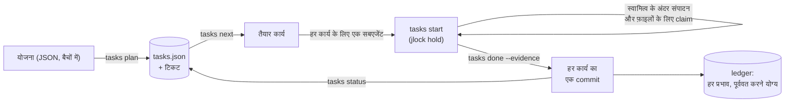

<!-- languages -->
[English](README.md) · [Português (Brasil)](README.pt-BR.md) · [Español](README.es.md) · [Français](README.fr.md) · [Deutsch](README.de.md) · [Italiano](README.it.md) · [简体中文](README.zh-CN.md) · [日本語](README.ja.md) · [Русский](README.ru.md) · [العربية](README.ar.md) · [हिन्दी](README.hi.md)

# jtasks

**jtasks एक योजना को कार्यों की सूची में बदलता है, जिसे AI कोडिंग एजेंट एक ही checkout में समानांतर रूप से पूरा करते हैं, एक-दूसरे के काम में दख़ल दिए बिना, हर कार्य का एक commit, और सब कुछ पूर्ववत किया जा सकता है।**

## jtasks क्यों है

AI कोडिंग एजेंट समानांतर काम कर सकते हैं, पर कोई लंबा लक्ष्य ("लॉगिन बनाओ", "पार्सर पोर्ट करो") जाने-पहचाने तरीकों से बिगड़ जाता है। मॉडल कार्यों की सूची अपने दिमाग़ में रखता है या किसी Markdown फ़ाइल में जिसे वह हाथ से संपादित करता है, और सूची धीरे-धीरे भटक जाती है: जो कार्य पूरा नहीं हुआ उसे पूरा मान लिया जाता है, दो सबएजेंट एक ही कार्य उठा लेते हैं, कोई निर्भरता भूल जाती है। एक साथ चल रहे एजेंट एक ही फ़ाइल संपादित करते हैं और एक दूसरे का काम मिटा देता है। commit में कई कार्यों का काम मिल जाता है, इसलिए किसी एक को अकेले revert नहीं किया जा सकता। और जब कोई सत्र मर जाता है, तो किसी को नहीं पता कि कौन सा कार्य आधा हुआ था।

jtasks यह सब मॉडल से निकालकर एक टूल में ले जाता है। योजना एक बार जाँची जाती है; सूची एक JSON फ़ाइल में रहती है जिसे केवल टूल लिखता है; हर कार्य उन फ़ाइलों की घोषणा करता है जो उसकी हैं, और कार्य चलने के दौरान वे फ़ाइलें लॉक रहती हैं।

## समस्या, ठीक-ठीक

- **अभी क्या चल सकता है।** कोई कार्य तब तैयार होता है जब उसकी निर्भरताएँ पूरी हो चुकी हों और उसकी फ़ाइलें मुक्त हों। जिन दो कार्यों के बीच कोई निर्भरता नहीं है, वे कोई फ़ाइल साझा नहीं कर सकते: टूल ऐसी योजना अस्वीकार करता है और बताता है कि कौन से कार्य और कौन सी फ़ाइल।
- **कौन क्या बदलता है।** कार्य चलने के दौरान उसकी फ़ाइलें [jlock](https://github.com/rodrigojager/jlock) में लॉक के रूप में रखी जाती हैं, जो पूरी मशीन पर लागू लॉक टूल है। जिस दूसरे कार्य को उनमें से कोई फ़ाइल चाहिए, वह कतार में प्रतीक्षा करता है (`claim`) या कुछ और करता है; जो प्रतीक्षा एक चक्र बना दे, उसे अस्वीकार कर दिया जाता है।
- **वादे नहीं, सबूत।** कार्य `done` और उसके सबूत के साथ पूरा होता है; टूल जाँचता है कि केवल उसकी फ़ाइलें बदलीं और commit बनाता है (`T04: शीर्षक`)। हर कार्य का एक commit: किसी कार्य को revert करना एक commit को revert करना है।
- **फिर से शुरू करना।** रन कहाँ तक पहुँचा, यह सूची की स्थिति बताती है, मॉडल की याददाश्त नहीं: किसी भी विंडो में `tasks resume` दिखाता है कि क्या पूरा हुआ, क्या चल रहा है, क्या प्रतीक्षा में है, और मर चुके एजेंट के कार्य वापस कतार में लौटा देता है।
- **पूर्ववत करना।** ब्रांच, commit, फ़ोल्डर, `.git/info/exclude` की पंक्तियाँ: टूल जो भी प्रभाव छोड़ता है, वह ledger में उसे पूर्ववत करने के तरीके के साथ दर्ज होता है (`tasks ledger`, `tasks undo`)।

## यह कैसे काम करता है



टूल के तीन रूप हैं, सभी में वही कमांड: Claude Code के लिए एक mod (एक `tasks` टूल, चेकलिस्ट और प्रगति पट्टी वाला एक पैन, `/jtasks`), OpenCode के लिए एक प्लगइन (वही टूल और साइडबार में एक खंड), और एक CLI, `tasks`, टर्मिनल या किसी भी दूसरे एजेंट के लिए। जब कोई रन किसी सत्र से बँधा होता है, mod और प्लगइन मॉडल के प्रॉम्प्ट में प्रोटोकॉल डालते हैं: `tasks next`, हर तैयार कार्य के लिए एक सबएजेंट, और `tasks status` जब तक कुछ शेष न रहे। एक गार्ड कार्य के स्वामित्व के बाहर संपादन और सबएजेंट की git कमांड को अस्वीकार करता है।

## इंस्टॉल

आपको [bun](https://bun.sh) और `git` चाहिए। इस रिपॉज़िटरी के क्लोन से:

```
bun install
bun link            # एक `tasks` कमांड (या bun cli/tasks.ts <action> चलाएँ)
tasks doctor        # क्या यह मशीन तैयार है?
tasks doctor --fix --yes   # जो नहीं है उसे इंस्टॉल करता है: jlock, OpenCode के एजेंट, स्किल
```

`--yes` के बिना `tasks doctor --fix` केवल यह सूची दिखाता है कि वह क्या करेगा। वह जो कुछ इंस्टॉल करता है, सब ledger में जाता है, इसलिए `tasks undo` उसे हटा देता है। फिर, अपने एजेंट के लिए:

- **Claude Code:** `claude --plugin-dir <jtasks>/claude` (mod; देखें [`claude/README.md`](claude/README.md))।
- **OpenCode:** `opencode.json` में `plugins` में `<jtasks>/opencode` जोड़ें (देखें [`opencode/README.md`](opencode/README.md))।
- **Codex या टर्मिनल:** [`skills/`](skills/README.md) की स्किल एजेंट को कमांड सिखाती हैं।

## पाँच मिनट में

तीन कार्यों वाली एक योजना: दो जो साथ चल सकते हैं और एक जो उन्हें जोड़ता है।

```json
{
  "objective": "A sum, its docs, and the entry point",
  "tasks": [
    { "id": "T01", "title": "Sum", "files": ["src/sum.ts"], "acceptance": ["sum.ts exports sum"] },
    { "id": "T02", "title": "Docs", "files": ["docs/sum.md"] },
    { "id": "T03", "title": "Entry", "dependsOn": ["T01", "T02"], "files": ["src/index.ts"] }
  ]
}
```

<!-- jtasks-example -->
```text
$ tasks plan @plan.json
रन a-sum-its-docs-and-the-e-261024-1k5o बनाया गया: 3 कार्य, branch gt/a-sum-its-docs-and-the-e-261024-1k5o
टिकट: ~/project/.scratch/jtasks/runs/a-sum-its-docs-and-the-e-261024-1k5o/tickets में 3
अगला कदम: tasks next

$ tasks next
a-sum-its-docs-and-the-e-261024-1k5o में तैयार (2); ये समानांतर चल सकते हैं:
T01 · Sum · प्रोफ़ाइल implement · स्वामित्व: src/sum.ts
  मानदंड: sum.ts exports sum
  ticket: ~/project/.scratch/jtasks/runs/a-sum-its-docs-and-the-e-261024-1k5o/tickets/01-sum.md
T02 · Docs · प्रोफ़ाइल implement · स्वामित्व: docs/sum.md
  ticket: ~/project/.scratch/jtasks/runs/a-sum-its-docs-and-the-e-261024-1k5o/tickets/02-docs.md
अवरुद्ध: T03 ⛔ T01, T02

$ tasks start T01
T01 प्रगति पर (प्रयास 1): स्वामित्व jlock में लॉक (1 कुंजी, स्वामी gt:a-sum-its-docs-and-the-e-261024-1k5o/T01)
ticket: ~/project/.scratch/jtasks/runs/a-sum-its-docs-and-the-e-261024-1k5o/tickets/01-sum.md
दूसरी फ़ाइल: tasks claim T01 <फ़ाइल>; अंत में: tasks done T01 --evidence "…" (या tasks fail T01 --error "…")

$ echo "export const sum = (a: number, b: number) => a + b" > src/sum.ts
$ tasks done T01 --evidence "sum.ts exports sum"
T01 पूरा: commit 9a4a0e5 (T01: Sum); स्वामित्व लौटाया गया
पूरे 1/3 (33%) · 2 शेष

$ tasks status
पूरे 1/3 (33%) · 2 शेष
तैयार: T02
अवरुद्ध: T03 ⛔ T02
सक्रिय लॉक: कोई नहीं
```

`tasks next` ने T01 और T02 एक साथ लौटाए: उनकी फ़ाइलें आपस में नहीं टकरातीं, इसलिए दो एजेंट उन्हें एक साथ ले सकते हैं। T03 दोनों की प्रतीक्षा करता है। `done` ने केवल `src/sum.ts` के साथ commit `T01: Sum` बनाया।

## Claude Code के साथ

mod लोड होने पर, Claude से `to-tickets` स्किल (यह mod के साथ आती है) से योजना बनाने को कहें: वह काम को कार्यों में बाँटता है, आपसे उन्हें स्वीकृत करवाता है, और योजना को बैचों में टूल को सौंपता है। फिर एक लक्ष्य शुरू करें:

```
/goal रन <run> का हर कार्य पूरा या स्किप हो चुका है (tasks status बताता है कि कुछ शेष नहीं)
```

Claude `tasks next` बुलाता है, उसी उत्तर में हर तैयार कार्य के लिए एक सबएजेंट खोलता है (हर एक अपनी प्रोफ़ाइल के मॉडल पर), और `tasks status` तब तक बुलाता है जब तक कुछ शेष न रहे। `/jtasks` पैन खोलता या बंद करता है।

## OpenCode के साथ

प्लगइन के साथ भी यही: योजना के लिए `to-tickets`, फिर एक लक्ष्य। हर कार्य की `subagent` कॉल को उसकी प्रोफ़ाइल का एजेंट मिलता है (`implement`, `implement-deep`, `review`, जिन्हें `tasks doctor --fix --yes` इंस्टॉल करता है, या योजना में आपके बताए किसी भी एजेंट)। साइडबार चेकलिस्ट और प्रगति पट्टी दिखाता है।

## टर्मिनल या Codex से

mod या प्लगइन के बिना, `jtasks` स्किल ही प्रोटोकॉल है: एजेंट `tasks next` चलाता है, हर कार्य उसके स्वामित्व के अंदर करता है (`tasks start`, `tasks claim`, `tasks done`), और तब तक दोहराता है जब तक `tasks status` यह न बताए कि कुछ शेष नहीं। कोई व्यक्ति भी यही हाथ से कर सकता है।

## गारंटियाँ और सीमाएँ

| jtasks गारंटी देता है | यह नहीं करता |
|---|---|
| सूची केवल टूल लिखता है; हर बदलाव जाँचा जाता है और परमाणु (atomic) होता है | jlock को अनदेखा करने वाले प्रोग्राम को फ़ाइल संपादित करने से रोकना |
| कार्य चलने के दौरान उसकी फ़ाइलें jlock में लॉक रहती हैं; समानांतर कार्य कभी कोई फ़ाइल साझा नहीं करते | फ़ाइल के हिस्सों को लॉक करना: स्वामित्व फ़ाइल और फ़ोल्डर के स्तर पर है |
| हर कार्य का एक commit, केवल उसी कार्य की फ़ाइलों के साथ | टूल के बाहर किए गए काम को merge करना |
| हर प्रभाव ledger में है और पूर्ववत किया जा सकता है | वह पूर्ववत करना जो उसने नहीं बनाया |
| मर चुके एजेंट या विंडो के लॉक वापस मिल जाते हैं (OpenCode में तुरंत, बाकी में समयसीमा पर) | कई मशीनों पर काम करना (jlock एक मशीन के लिए है) |

पहले Windows: jlock और jtasks Windows पर जाँचे गए हैं; Linux और macOS jlock की अपनी योजना के अनुसार आएँगे।

## कॉन्फ़िगरेशन

| वेरिएबल | डिफ़ॉल्ट | उपयोग |
|---|---|---|
| `JTASKS_HOME` | `~/.jtasks` | वैश्विक ledger और आर्काइव किए गए रन |
| `JTASKS_LANG` | सिस्टम की भाषा | उत्तरों की भाषा (कमांड पर `--lang` को प्राथमिकता) |
| `JTASKS_RUN` | सेट नहीं | वह रन जिस पर CLI काम करता है, `--run` की जगह |
| `JLOCK_BIN` | `jlock` | jlock का executable |

ग्यारह भाषाएँ, वही जो jlock में हैं: English, Português (Brasil), Español, Français, Deutsch, Italiano, 简体中文, 日本語, Русский, العربية, हिन्दी। हर कमांड [`docs/USAGE.md`](docs/USAGE.md) में है; डिज़ाइन (पुर्तगाली में) [`docs/PLAN.md`](docs/PLAN.md) है, और जो अलग निकला वह [`docs/DEVIATIONS.md`](docs/DEVIATIONS.md) में है।

## योगदान

issue और pull request का स्वागत है; देखें [`CONTRIBUTING.md`](CONTRIBUTING.md)। टेक्स्ट की समीक्षा किसी भी भाषा में स्वागत योग्य है, अंग्रेज़ी भी, और इसके लिए TypeScript की ज़रूरत नहीं: टेक्स्ट `locales/` में JSON फ़ाइलें हैं।

## लेखक

Rodrigo Jäger — GitHub <https://github.com/rodrigojager> · LinkedIn <https://www.linkedin.com/in/rodrigojager>

## लाइसेंस

MIT, देखें [`LICENSE`](LICENSE)।

यह अनुवाद किसी मूल हिंदी भाषी की समीक्षा की प्रतीक्षा में है; सुधारों का स्वागत है ([CONTRIBUTING.md](CONTRIBUTING.md) देखें)।
