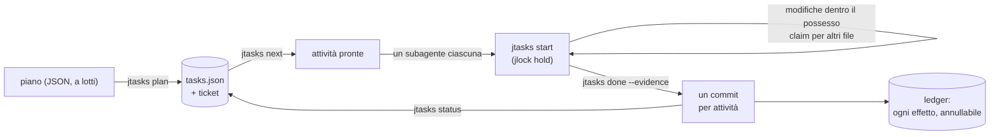

<!-- languages -->
[English](README.md) · [Português (Brasil)](README.pt-BR.md) · [Español](README.es.md) · [Français](README.fr.md) · [Deutsch](README.de.md) · [Italiano](README.it.md) · [简体中文](README.zh-CN.md) · [日本語](README.ja.md) · [Русский](README.ru.md) · [العربية](README.ar.md) · [हिन्दी](README.hi.md)

# jtasks

**jtasks trasforma un piano in una lista di attività che gli agenti AI di programmazione portano avanti in
parallelo, nello stesso checkout, senza pestarsi i piedi, con un commit per attività e tutto annullabile.**

## Perché esiste jtasks

Gli agenti AI di programmazione possono lavorare in parallelo, ma un obiettivo lungo ("costruisci il login", "porta
il parser") va storto in modi noti. Il modello tiene la lista delle attività a mente o in un file Markdown che
modifica a mano, e la lista deriva: un'attività viene segnata come fatta quando non lo è, due subagenti prendono la
stessa attività, una dipendenza viene dimenticata. Agenti che girano nello stesso momento modificano lo stesso file
e uno sovrascrive l'altro. I commit mescolano il lavoro di più attività, quindi non se ne può annullare una da
sola. E quando una sessione muore, nessuno sa quale attività era a metà.

jtasks sposta tutto questo fuori dal modello, dentro uno strumento. Il piano viene convalidato una volta; la
lista vive in un file JSON che solo lo strumento scrive; ogni attività dichiara i file che possiede, e quei file
restano bloccati mentre è in corso.

## Il problema, con precisione

- **Cosa può partire adesso.** Un'attività è pronta quando le sue dipendenze sono completate e i suoi file sono
  liberi. Due attività senza dipendenza tra loro non devono condividere un file: lo strumento rifiuta un piano così
  e dice quali attività e quale file.
- **Chi modifica cosa.** Mentre un'attività è in corso, i suoi file sono tenuti come blocchi in
  [jlock](https://github.com/rodrigojager/jlock), uno strumento di blocchi per tutta la macchina. Un'altra attività
  che ne ha bisogno aspetta in coda (`claim`) o fa altro; un'attesa che chiuderebbe un ciclo viene rifiutata.
- **Prove, non promesse.** Un'attività si chiude con `done` e la sua prova; lo strumento verifica che siano
  cambiati solo i suoi file e fa il commit (`T04: titolo`). Un commit per attività: annullare un'attività è
  annullare un commit.
- **Riprendere.** A che punto è l'esecuzione lo dice lo stato della lista, non la memoria del modello:
  `jtasks resume` in qualsiasi finestra mostra cosa è completato, cosa è in corso, cosa aspetta, e restituisce le
  attività di un agente morto.
- **Annullare.** Branch, commit, cartelle, righe in `.git/info/exclude`: ogni effetto che lo strumento lascia è nel
  ledger insieme al modo di annullarlo (`jtasks ledger`, `jtasks undo`).

## Come funziona



Lo strumento ha tre forme con gli stessi comandi: un mod per Claude Code (uno strumento `jtasks`, un pannello con la
checklist e una barra di avanzamento, `/jtasks`), un plugin per OpenCode (lo stesso strumento e una sezione nella
barra laterale) e un CLI, `jtasks`, per un terminale o qualsiasi altro agente. Finché un'esecuzione è legata a una
sessione, il mod e il plugin mettono il protocollo nel prompt del modello: `jtasks next`, un subagente per ogni
attività pronta, `jtasks status` finché non resta nulla. Una guardia rifiuta le modifiche fuori dal possesso
dell'attività e i comandi git dei subagenti.

## Installazione

Servono [bun](https://bun.sh) e `git`. Da un clone di questo repository:

```
git clone https://github.com/rodrigojager/jtasks
cd jtasks
bun install
bun link            # un comando `jtasks` (oppure bun cli/jtasks.ts <azione>)
jtasks doctor        # questa macchina è pronta?
jtasks doctor --fix --yes   # installa ciò che manca: jlock, gli agenti di OpenCode, le skill
```

**jlock è incluso.** jtasks tiene i suoi lock in [jlock](https://github.com/rodrigojager/jlock), e non serve installarlo a mano: il primo
comando che ne ha bisogno, nella CLI, nel mod o nel plugin, lo installa con l'installer ufficiale se manca (il mod e
il plugin appena si caricano) e dice dove. `jtasks undo` lo rimuove; con `JTASKS_NO_JLOCK_INSTALL=1`, jlock resta a
carico tuo.

`jtasks doctor --fix` senza `--yes` elenca soltanto ciò che farebbe. Tutto ciò che installa finisce nel ledger,
quindi `jtasks undo` lo rimuove. Poi, per il tuo agente:

- **Claude Code:** `/plugin install jtasks --marketplace rodrigojager/jtasks` (il mod; vedi [`claude/README.md`](claude/README.md)).
- **OpenCode:** aggiungi `<jtasks>/opencode` a `plugins` in `opencode.json` (vedi
  [`opencode/README.md`](opencode/README.md)).
- **Codex o un terminale:** le skill in [`skills/`](skills/README.md) insegnano i comandi all'agente.

## Cinque minuti

Un piano con tre attività: due che possono andare insieme e una che le unisce.

```json
{
  "objective": "A sum, its docs, and the entry point",
  "tasks": [
    { "id": "T01", "title": "Sum", "files": ["src/sum.ts"], "acceptance": ["sum.ts exports sum"] },
    { "id": "T02", "title": "Docs", "files": ["docs/sum.md"] },
    { "id": "T03", "title": "Entry", "dependsOn": ["T01", "T02"], "files": ["src/index.ts"] }
  ]
}
```

<!-- jtasks-example -->
```text
$ jtasks plan @plan.json
esecuzione a-sum-its-docs-and-the-e-261024-1rn4 creata: 3 attività, branch gt/a-sum-its-docs-and-the-e-261024-1rn4
ticket: 3 in ~/project/.scratch/jtasks/runs/a-sum-its-docs-and-the-e-261024-1rn4/tickets
prossimo passo: jtasks next

$ jtasks next
pronte (2) in a-sum-its-docs-and-the-e-261024-1rn4; possono andare in parallelo:
T01 · Sum · profilo execute · possesso: src/sum.ts
  criteri: sum.ts exports sum
  ticket: ~/project/.scratch/jtasks/runs/a-sum-its-docs-and-the-e-261024-1rn4/tickets/01-sum.md
T02 · Docs · profilo execute · possesso: docs/sum.md
  ticket: ~/project/.scratch/jtasks/runs/a-sum-its-docs-and-the-e-261024-1rn4/tickets/02-docs.md
bloccate: T03 ⛔ T01, T02

$ jtasks start T01
T01 in corso (tentativo 1): possesso bloccato in jlock (chiavi: 1, proprietario gt:a-sum-its-docs-and-the-e-261024-1rn4/T01)
ticket: ~/project/.scratch/jtasks/runs/a-sum-its-docs-and-the-e-261024-1rn4/tickets/01-sum.md
un altro file: jtasks claim T01 <file>; alla fine: jtasks done T01 --evidence "…" (o jtasks fail T01 --error "…")

$ echo "export const sum = (a: number, b: number) => a + b" > src/sum.ts
$ jtasks done T01 --evidence "sum.ts exports sum"
T01 completata: commit 99d665b (T01: Sum); possesso restituito
completate 1/3 (33%) · 2 rimaste

$ jtasks status
completate 1/3 (33%) · 2 rimaste
pronte: T02
bloccate: T03 ⛔ T02
blocchi attivi: nessuno
```

`jtasks next` ha restituito T01 e T02 insieme: i loro file non si sovrappongono, quindi due agenti possono prenderle
contemporaneamente. T03 aspetta entrambe. `done` ha fatto il commit `T01: Sum` con il solo `src/sum.ts`.

## Con Claude Code

Con il mod caricato, chiedi a Claude di pianificare con la skill `to-jtasks` (viaggia insieme al mod): divide il
lavoro in attività, ti chiede di approvarle e consegna il piano allo strumento a lotti. Poi avvia un obiettivo:

```
/goal ogni attività dell'esecuzione <run> è completata o saltata (jtasks status dice che non resta nulla)
```

Claude chiama `jtasks next`, apre un subagente per ogni attività pronta nella stessa risposta (ciascuno con il
modello del suo profilo) e chiama `jtasks status` finché non resta nulla. `/jtasks` apre o chiude il pannello.

Se un turno finisce con un'attività pronta e nessun subagente in corso (dopo una compattazione, per esempio),
il mod manda a Claude un messaggio che riapre il ciclo; dopo due senza progressi si ferma e ti avvisa. Per
fermarsi di proposito, Claude chiama `jtasks pause` e ti chiede; `jtasks keepalive off` lo disattiva.

## Con OpenCode

Con il plugin, lo stesso: `to-jtasks` per pianificare, poi un obiettivo. La chiamata `subagent` di ogni attività
riceve l'agente del suo profilo (`execute`, `execute-deep`, `review`, installati da `jtasks doctor --fix --yes`,
o qualsiasi agente tu indichi nel piano). La barra laterale mostra la checklist e la barra di avanzamento.

Quando la sessione resta inattiva con un'attività pronta e niente in corso, il plugin riapre il ciclo allo
stesso modo.

## Da un terminale o da Codex

Senza mod né plugin, la skill `jtasks` è il protocollo: l'agente esegue `jtasks next`, svolge ogni attività
dentro il suo possesso (`jtasks start`, `jtasks claim`, `jtasks done`) e ripete finché `jtasks status` non dice che non
resta nulla. Una persona può fare lo stesso a mano.

## Garanzie e limiti

| jtasks garantisce | Non fa |
|---|---|
| Solo lo strumento scrive la lista; ogni modifica è convalidata e atomica | impedire a un programma che ignora jlock di modificare un file |
| I file di un'attività sono bloccati in jlock mentre è in corso; attività parallele non condividono mai un file | bloccare parti di un file: il possesso è per file e cartella |
| Un commit per attività, con i soli file di quell'attività | integrare lavoro fatto fuori dallo strumento |
| Ogni effetto è nel ledger e può essere annullato | annullare ciò che non ha creato |
| I blocchi di un agente o di una finestra morti tornano liberi (subito con OpenCode, altrimenti alla scadenza) | lavorare tra più macchine (jlock è una macchina) |

Prima Windows: jlock e jtasks sono stati convalidati su Windows; Linux e macOS seguono il piano di jlock.

## Configurazione

| Variabile | Predefinito | Uso |
|---|---|---|
| `JTASKS_HOME` | `~/.jtasks` | il ledger globale e le esecuzioni archiviate |
| `JTASKS_LANG` | quella del sistema | la lingua delle risposte (`--lang` su un comando ha la precedenza) |
| `JTASKS_RUN` | non impostata | l'esecuzione su cui lavora il CLI, al posto di `--run` |
| `JLOCK_BIN` | `jlock` | l'eseguibile di jlock |
| `JTASKS_NO_JLOCK_INSTALL` | non impostata | `1`: non installa mai jlock da solo |

Undici lingue, le stesse di jlock: English, Português (Brasil), Español, Français, Deutsch, Italiano, 简体中文, 日本語,
Русский, العربية, हिन्दी. Ogni comando è in [`docs/USAGE.md`](docs/USAGE.md); il progetto (in portoghese) è
[`docs/PLAN.md`](docs/PLAN.md), e ciò che è venuto diverso è in [`docs/DEVIATIONS.md`](docs/DEVIATIONS.md).

## Contribuire

Issue e pull request sono benvenute; vedi [`CONTRIBUTING.md`](CONTRIBUTING.md). Le revisioni dei testi sono
benvenute in qualsiasi lingua, inglese compreso, e non richiedono TypeScript: i testi sono file JSON in `locales/`.

## Autore

Rodrigo Jäger — GitHub <https://github.com/rodrigojager> · LinkedIn <https://www.linkedin.com/in/rodrigojager>

## Licenza

MIT, vedi [`LICENSE`](LICENSE).
