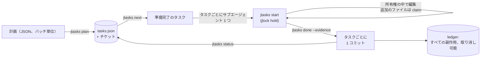

<!-- languages -->
[English](README.md) · [Português (Brasil)](README.pt-BR.md) · [Español](README.es.md) · [Français](README.fr.md) · [Deutsch](README.de.md) · [Italiano](README.it.md) · [简体中文](README.zh-CN.md) · [日本語](README.ja.md) · [Русский](README.ru.md) · [العربية](README.ar.md) · [हिन्दी](README.hi.md)

# jtasks

**jtasks は計画をタスクのリストに変え、AI コーディングエージェントが同じチェックアウトの中で、互いの作業を踏みつけることなく並列に実行できるようにします。コミットはタスクごとに 1 つで、すべて取り消せます。**

## jtasks がある理由

AI コーディングエージェントは並列に作業できますが、長い目標（「ログインを作る」「パーサーを移植する」）は、おなじみのパターンでうまくいかなくなります。モデルはタスクリストを頭の中か、手で編集する Markdown ファイルに持っていて、リストは少しずつずれていきます。終わっていないタスクが完了とされ、2 つのサブエージェントが同じタスクを取り、依存関係が忘れられます。同時に動くエージェントが同じファイルを編集し、一方が他方を上書きします。コミットに複数のタスクの作業が混ざるので、1 つだけを revert することができません。そしてセッションが落ちると、どのタスクが途中だったのか誰にもわかりません。

jtasks はそのすべてをモデルから取り出し、ツールに移します。計画は一度だけ検証され、リストはツールだけが書き込む JSON ファイルに置かれます。各タスクは自分が所有するファイルを宣言し、それらのファイルはタスクの実行中ロックされます。

## 問題を正確に言うと

- **今何を実行できるか。** タスクは、依存先が完了し、ファイルが空いているときに準備完了になります。互いに依存関係のない 2 つのタスクはファイルを共有してはいけません。ツールはそのような計画を拒否し、どのタスクとどのファイルかを示します。多くのタスクが触れる登録ファイルは計画の `shared` に書きます。並行する 2 つのタスクが同じものに触れるとツールが警告し、`"sharedPolicy": "serialize"` なら同時には走らせません。
- **誰が何を変えるか。** タスクの実行中、そのファイルはマシン全体のロックツール [jlock](https://github.com/rodrigojager/jlock) にロックとして保持されます。そのうちの 1 つが必要な別のタスクは、キューに並んで待つ（`claim`）か、別のことをします。循環を作るような待ちは拒否されます。拒否されたタスクは `jtasks yield` で譲ります。競合しているファイルだけを返し、編集はパッチとして保存されてファイルと一緒に戻り、作業を続けます。
- **約束ではなく証拠。** タスクは `done` と証拠をもって完了します。ツールはそのタスクのファイルだけが変わったことを確認し、コミット（`T04: タイトル`）を作ります。タスクごとに 1 コミットなので、タスクを revert することはコミットを 1 つ revert することです。
- **再開。** 実行がどこまで進んだかは、モデルの記憶ではなくリストの状態でわかります。どのウィンドウでも `jtasks resume` を実行すれば、何が完了し、何が進行中で、何が待っているかが表示され、落ちたエージェントが持っていたタスクが戻されます。
- **取り消し。** ブランチ、コミット、フォルダ、`.git/info/exclude` の行など、ツールが残す副作用はすべて、取り消し方とともに ledger に記録されます（`jtasks ledger`、`jtasks undo`）。

## 仕組み



ツールには同じコマンドを持つ 3 つの形があります。Claude Code 用の mod（`jtasks` ツール、チェックリストと進捗バーを表示するペイン、`/jtasks`）、OpenCode 用のプラグイン（同じツールとサイドバーのセクション）、そしてターミナルや他のエージェント向けの CLI `jtasks` です。実行がセッションに結び付いている間、mod とプラグインはモデルのプロンプトにプロトコルを入れます。`jtasks next`、準備完了のタスクごとにサブエージェント 1 つ、そして残りがなくなるまで `jtasks status`。ガードは、タスクの所有権の外での編集と、サブエージェントからの git コマンドを拒否します。

## インストール

[bun](https://bun.sh) と `git` が必要です。このリポジトリのクローンで:

```
git clone https://github.com/rodrigojager/jtasks
cd jtasks
bun install
bun link            # `jtasks` コマンドを作る（または bun cli/jtasks.ts <action> を実行）
jtasks doctor        # このマシンは準備できているか?
jtasks doctor --fix --yes   # 足りないものをインストール: jlock、OpenCode のエージェント、スキル
```

**jlock は jtasks に付いてきます。** jtasks はロックを [jlock](https://github.com/rodrigojager/jlock) で管理しますが、自分でインストールする必要はありません。CLI・mod・プラグインのいずれでも、jlock を必要とする最初のコマンドが、見つからなければ公式インストーラーでインストールし（mod とプラグインは読み込まれた時点で）、場所を知らせます。`jtasks undo` で削除でき、`JTASKS_NO_JLOCK_INSTALL=1` なら jlock は自分で管理します。

`--yes` なしの `jtasks doctor --fix` は、何をするかを一覧にするだけです。インストールしたものはすべて ledger に入るので、`jtasks undo` で削除できます。そのうえで、使うエージェントに合わせて:

- **Claude Code:** `/plugin install jtasks --marketplace rodrigojager/jtasks`（mod。[`claude/README.md`](claude/README.md) を参照）。
- **OpenCode:** `opencode.json` の `plugins` に `<jtasks>/opencode` を追加（[`opencode/README.md`](opencode/README.md) を参照）。
- **Codex またはターミナル:** [`skills/`](skills/README.md) のスキルがエージェントにコマンドを教えます。

## 5 分で試す

3 つのタスクを持つ計画です。2 つは同時に実行でき、残りの 1 つがそれらをまとめます。

```json
{
  "objective": "A sum, its docs, and the entry point",
  "tasks": [
    { "id": "T01", "title": "Sum", "files": ["src/sum.ts"], "acceptance": ["sum.ts exports sum"] },
    { "id": "T02", "title": "Docs", "files": ["docs/sum.md"] },
    { "id": "T03", "title": "Entry", "dependsOn": ["T01", "T02"], "files": ["src/index.ts"] }
  ]
}
```

<!-- jtasks-example -->
```text
$ jtasks plan @plan.json
実行 a-sum-its-docs-and-the-e-261024-bvqd を作成: タスク 3 件、branch gt/a-sum-its-docs-and-the-e-261024-bvqd
チケット: 3 件（~/project/.scratch/jtasks/runs/a-sum-its-docs-and-the-e-261024-bvqd/tickets）
次の手順: jtasks next

$ jtasks next
a-sum-its-docs-and-the-e-261024-bvqd で準備完了（2）。並列に実行できる:
T01 · Sum · プロファイル execute · 所有権: src/sum.ts
  受け入れ基準: sum.ts exports sum
  ticket: ~/project/.scratch/jtasks/runs/a-sum-its-docs-and-the-e-261024-bvqd/tickets/01-sum.md
T02 · Docs · プロファイル execute · 所有権: docs/sum.md
  ticket: ~/project/.scratch/jtasks/runs/a-sum-its-docs-and-the-e-261024-bvqd/tickets/02-docs.md
ブロック中: T03 ⛔ T01, T02

$ jtasks start T01
T01 進行中（試行 1）: 所有権を jlock でロック（キー 1 個、所有者 gt:a-sum-its-docs-and-the-e-261024-bvqd/T01）
ticket: ~/project/.scratch/jtasks/runs/a-sum-its-docs-and-the-e-261024-bvqd/tickets/01-sum.md
別のファイル: jtasks claim T01 <ファイル>。終わったら: jtasks done T01 --evidence "…"（または jtasks fail T01 --error "…"）

$ echo "export const sum = (a: number, b: number) => a + b" > src/sum.ts
$ jtasks done T01 --evidence "sum.ts exports sum"
T01 完了: commit e360b3d (T01: Sum)。所有権を返却
完了 1/3（33%） · 残り 2

$ jtasks status
完了 1/3（33%） · 残り 2
準備完了: T02
ブロック中: T03 ⛔ T02
有効なロック: なし
```

`jtasks next` は T01 と T02 を一緒に返しました。ファイルが重ならないので、2 つのエージェントが同時に取りかかれます。T03 は両方を待ちます。`done` は `src/sum.ts` だけを含むコミット `T01: Sum` を作りました。

## Claude Code で使う

mod を読み込んだら、`to-jtasks` スキル（mod に同梱）で計画を立てるよう Claude に頼みます。Claude は作業をタスクに分け、承認を求め、計画をバッチ単位でツールに渡します。それから目標を設定します:

```
/goal 実行 <run> のすべてのタスクが完了またはスキップされている（jtasks status で残りがない）
```

Claude は `jtasks next` を呼び、同じ応答の中で準備完了のタスクごとにサブエージェントを 1 つ開き（それぞれプロファイルのモデルで動きます）、残りがなくなるまで `jtasks status` を呼びます。`/jtasks` でペインを開閉します。

タスクが準備済みで動いているサブエージェントがないままターンが終わると（たとえばコンパクションの後）、mod がループを再開するメッセージを Claude に送ります。進捗のないメッセージが 2 回続くと止まってあなたに知らせます。意図して止めるときは、Claude が `jtasks pause` を呼んであなたに尋ねます。`jtasks keepalive off` でこの動作をオフにできます。

サブエージェント（または Claude 自身）が自然に回復する障害、たとえば利用上限やセッション上限、レート制限、API の過負荷、接続の切断で止まった場合、mod はタスクを戻さずに実行を一時停止します。タスクはロックを持ったまま進行中に残り、ペインに理由と再開の時刻が表示されます。リセット時（エラーが示した時刻、または Claude Code が利用上限のあと自動で続行したとき）や `jtasks unpause` で実行は再びアクティブになり、Claude には新しく開かずに SendMessage で同じサブエージェントを再開するよう伝えられます。無効なキー、拒否、コンテキストのあふれはこれまでどおりです。新しいリリースを入れるには `claude plugin marketplace update jtasks`、続けて `claude plugin update jtasks@jtasks` を実行し、Claude Code を再起動します。

## OpenCode で使う

プラグインでも同じです。`to-jtasks` で計画を立て、目標を設定します。各タスクの `subagent` 呼び出しには、そのプロファイルのエージェント（`execute`、`execute-deep`、`review`。`jtasks doctor --fix --yes` でインストールされます。または計画で指定した任意のエージェント）が割り当てられます。サイドバーにはチェックリストと進捗バーが表示されます。

タスクが準備済みで何も動いていない状態でセッションがアイドルになると、プラグインも同じようにループを再開します。

プロバイダーの一時的な障害でセッションが失敗した場合も（opencode/zen、本文に上流のエラーを含む OpenRouter、Anthropic、OpenAI、Moonshot/Kimi、OpenAI 互換のプロバイダーを認識します）、同じように実行を一時停止し、タスクは進行中のままです。リセット時にプラグインが再開し、セッションに同じサブエージェント（`task_id`）を続けるよう伝えます。

## ターミナルまたは Codex から使う

mod もプラグインもないときは、`jtasks` スキルがプロトコルになります。エージェントは `jtasks next` を実行し、各タスクをその所有権の中で行い（`jtasks start`、`jtasks claim`、`jtasks done`）、`jtasks status` で残りがなくなるまで繰り返します。人が手で同じことをすることもできます。

## 保証と限界

| jtasks が保証すること | しないこと |
|---|---|
| リストに書き込むのはツールだけ。すべての変更は検証され、アトミック | jlock を無視するプログラムがファイルを編集するのを止める |
| タスクのファイルは実行中 jlock でロックされる。並列のタスクがファイルを共有することはない | ファイルの一部だけをロックする: 所有権はファイルとフォルダ単位 |
| タスクごとに 1 コミット、そのタスクのファイルだけを含む | ツールの外で行われた作業をマージする |
| すべての副作用は ledger にあり、取り消せる | 自分が作っていないものを取り消す |
| 落ちたエージェントやウィンドウのロックは戻ってくる（OpenCode ではすぐに、それ以外は時間制限で） | 複数のマシンにまたがって動く（jlock は 1 台のマシン用） |

Windows を優先: jlock と jtasks は Windows で検証済みです。Linux と macOS は jlock 自身の計画に従います。

## 設定

| 変数 | 既定値 | 用途 |
|---|---|---|
| `JTASKS_HOME` | `~/.jtasks` | グローバル ledger とアーカイブされた実行 |
| `JTASKS_LANG` | システムの言語 | 応答の言語（コマンドの `--lang` が優先） |
| `JTASKS_RUN` | 未設定 | `--run` の代わりに CLI が扱う実行 |
| `JLOCK_BIN` | `jlock` | jlock の実行ファイル |
| `JTASKS_NO_JLOCK_INSTALL` | 未設定 | `1`: jlock を自動でインストールしない |

jlock と同じ 11 言語に対応しています: English、Português (Brasil)、Español、Français、Deutsch、Italiano、简体中文、日本語、Русский、العربية、हिन्दी。すべてのコマンドは [`docs/USAGE.md`](docs/USAGE.md) にあります。設計（ポルトガル語）は [`docs/PLAN.md`](docs/PLAN.md)、設計と違う結果になった点は [`docs/DEVIATIONS.md`](docs/DEVIATIONS.md) にあります。

## 貢献

issue と pull request を歓迎します。[`CONTRIBUTING.md`](CONTRIBUTING.md) を参照してください。テキストのレビューは英語を含むどの言語でも歓迎で、TypeScript の知識は要りません。テキストは `locales/` の JSON ファイルです。

## 作者

Rodrigo Jäger — GitHub <https://github.com/rodrigojager> · LinkedIn <https://www.linkedin.com/in/rodrigojager>

## ライセンス

MIT。[`LICENSE`](LICENSE) を参照してください。

この翻訳はネイティブスピーカーによるレビュー待ちです。修正を歓迎します（[CONTRIBUTING.md](CONTRIBUTING.md) を参照）。
