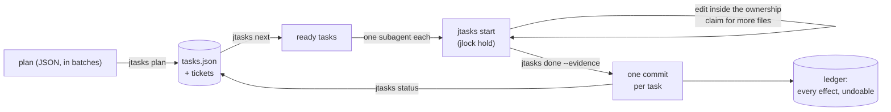

<!-- languages -->
[English](README.md) · [Português (Brasil)](README.pt-BR.md) · [Español](README.es.md) · [Français](README.fr.md) · [Deutsch](README.de.md) · [Italiano](README.it.md) · [简体中文](README.zh-CN.md) · [日本語](README.ja.md) · [Русский](README.ru.md) · [العربية](README.ar.md) · [हिन्दी](README.hi.md)

# jtasks

**jtasks turns a plan into a list of tasks that AI coding agents carry out in parallel, in the same checkout,
without stepping on each other, with one commit per task and everything undoable.**

## Why jtasks exists

AI coding agents can work in parallel, but a long goal ("build the login", "port the parser") goes wrong in
familiar ways. The model keeps the task list in its head or in a Markdown file it edits by hand, and the list drifts:
a task is marked done that is not, two subagents pick the same task, a dependency is forgotten. Agents running at
the same time edit the same file and one overwrites the other. Commits mix the work of several tasks, so one cannot
be reverted alone. And when a session dies, nobody knows which task was halfway.

jtasks moves all of that out of the model and into a tool. The plan is validated once; the list lives in a JSON
file only the tool writes; each task declares the files it owns, and those files are locked while it runs.

## The problem, precisely

- **What can run now.** A task is ready when its dependencies are done and its files are free. Two tasks with no
  dependency between them must not share a file: the tool refuses such a plan and says which tasks and which file. Registry files that many tasks touch go in the plan's `shared`: the tool warns
  when two parallel tasks touch one, and `"sharedPolicy": "serialize"` keeps them apart.
- **Who changes what.** While a task runs, its files are held as locks in [jlock](https://github.com/rodrigojager/jlock),
  a machine-wide lock tool. Another task that needs one of them waits in line (`claim`) or does something else; a
  wait that would close a cycle is refused. The task refused yields with `jtasks yield`: it gives back only the contested files, its edits kept as a patch
  that comes back with them, and goes on.
- **Proof, not promises.** A task is finished with `done` and its evidence; the tool checks that only its files
  changed and makes the commit (`T04: title`). One commit per task: reverting a task is reverting one commit.
- **Resuming.** Where the run stands is the state of the list, not the model's memory: `jtasks resume` in any
  window shows what is done, what runs, what waits, and gives back the tasks of an agent that died.
- **Undoing.** Branches, commits, folders, lines in `.git/info/exclude`: every effect the tool leaves is in a ledger
  with how to undo it (`jtasks ledger`, `jtasks undo`).

## How it works



The tool has three forms with the same commands: a mod for Claude Code (a `jtasks` tool, a pane with the checklist and
a progress bar, `/jtasks`), a plugin for OpenCode (the same tool and a section in the sidebar), and a CLI, `jtasks`,
for a terminal or any other agent. While a run is bound to a session, the mod and the plugin put the protocol in the
model's prompt: `jtasks next`, one subagent per ready task, `jtasks status` until nothing is left. A guard refuses an
edit outside the task's ownership and git commands from subagents.

## Install

You need [bun](https://bun.sh) and `git`. From a clone of this repository:

```
git clone https://github.com/rodrigojager/jtasks
cd jtasks
bun install
bun link            # a `jtasks` command (or run bun cli/jtasks.ts <action>)
jtasks doctor        # is this machine ready?
jtasks doctor --fix --yes   # installs what is missing: jlock, the OpenCode agents, the skills
```

**jlock comes with jtasks.** jtasks keeps its locks in [jlock](https://github.com/rodrigojager/jlock), and you do not install it yourself: the
first command that needs it, in the CLI, the mod or the plugin, installs it through its official installer when it
is missing (the mod and the plugin as soon as they load) and says where. `jtasks undo` removes it; with
`JTASKS_NO_JLOCK_INSTALL=1`, jlock is left to you.

`jtasks doctor --fix` without `--yes` only lists what it would do. Everything it installs goes to the ledger, so
`jtasks undo` removes it. Then, for your agent:

- **Claude Code:** `/plugin install jtasks --marketplace rodrigojager/jtasks` (the mod; see [`claude/README.md`](claude/README.md)).
- **OpenCode:** add `<jtasks>/opencode` to `plugins` in `opencode.json` (see [`opencode/README.md`](opencode/README.md)).
- **Codex or a terminal:** the skills in [`skills/`](skills/README.md) teach the agent the commands.

## Five minutes

A plan with three tasks: two that can run together and one that joins them.

```json
{
  "objective": "A sum, its docs, and the entry point",
  "tasks": [
    { "id": "T01", "title": "Sum", "files": ["src/sum.ts"], "acceptance": ["sum.ts exports sum"] },
    { "id": "T02", "title": "Docs", "files": ["docs/sum.md"] },
    { "id": "T03", "title": "Entry", "dependsOn": ["T01", "T02"], "files": ["src/index.ts"] }
  ]
}
```

<!-- jtasks-example -->
```text
$ jtasks plan @plan.json
run a-sum-its-docs-and-the-e-261024-gvus created: 3 task(s), branch gt/a-sum-its-docs-and-the-e-261024-gvus
tickets: 3 in ~/project/.scratch/jtasks/runs/a-sum-its-docs-and-the-e-261024-gvus/tickets
next step: jtasks next

$ jtasks next
ready (2) in a-sum-its-docs-and-the-e-261024-gvus; they can run in parallel:
T01 · Sum · profile execute · ownership: src/sum.ts
  criteria: sum.ts exports sum
  ticket: ~/project/.scratch/jtasks/runs/a-sum-its-docs-and-the-e-261024-gvus/tickets/01-sum.md
T02 · Docs · profile execute · ownership: docs/sum.md
  ticket: ~/project/.scratch/jtasks/runs/a-sum-its-docs-and-the-e-261024-gvus/tickets/02-docs.md
blocked: T03 ⛔ T01, T02

$ jtasks start T01
T01 in progress (attempt 1): ownership locked in jlock (1 key(s), owner gt:a-sum-its-docs-and-the-e-261024-gvus/T01)
ticket: ~/project/.scratch/jtasks/runs/a-sum-its-docs-and-the-e-261024-gvus/tickets/01-sum.md
another file: jtasks claim T01 <file>; at the end: jtasks done T01 --evidence "…" (or jtasks fail T01 --error "…")

$ echo "export const sum = (a: number, b: number) => a + b" > src/sum.ts
$ jtasks done T01 --evidence "sum.ts exports sum"
T01 done: commit 22c742c (T01: Sum); ownership given back
done 1/3 (33%) · 2 left

$ jtasks status
done 1/3 (33%) · 2 left
ready: T02
blocked: T03 ⛔ T02
active locks: none
```

`jtasks next` returned T01 and T02 together: their files do not overlap, so two agents can take them at once. T03
waits for both. `done` made the commit `T01: Sum` with only `src/sum.ts`.

## With Claude Code

With the mod loaded, ask Claude to plan with the `to-jtasks` skill (it travels with the mod): it breaks the work
into tasks, asks you to approve them, and hands the plan to the tool in batches. Then start a goal:

```
/goal every task of run <run> is done or skipped (jtasks status says nothing is left)
```

Claude calls `jtasks next`, opens one subagent per ready task in the same response (each on its profile's model), and
calls `jtasks status` until nothing is left. `/jtasks` opens or closes the pane.

If a turn ends with a task ready and no subagent running (after a compaction, say), the mod sends Claude a message
that reopens the loop; after two with no progress it stops and tells you. To stop on purpose, Claude calls `jtasks
pause` and asks you; `jtasks keepalive off` turns this off.

If a subagent (or Claude itself) dies on a failure that clears by itself, such as a usage or session limit, a rate
limit, an overloaded API or a dropped connection, the mod pauses the run instead of giving the task back: the task
stays in progress with its locks, and the pane says why and until when. At the reset (the time the error gave, or
when Claude Code goes on after a usage limit), or with `jtasks unpause`, the run is active again and Claude is told
to resume the same subagent with SendMessage, not to open another. An invalid key, a refusal or an overflowing
context go on as before. To get a new release: `claude plugin marketplace update jtasks`, then `claude plugin update
jtasks@jtasks`, and restart Claude Code.

## With OpenCode

With the plugin, the same: `to-jtasks` to plan, then a goal. Each task's `subagent` call gets the agent of its
profile (`execute`, `execute-deep`, `review`, installed by `jtasks doctor --fix --yes`, or any agent you name in
the plan). The sidebar shows the checklist and the progress bar.

When the session goes idle with a task ready and nothing running, the plugin reopens the loop the same way.

A session that fails on a provider failure that clears by itself (opencode/zen, OpenRouter with the upstream's error
in the body, Anthropic, OpenAI, Moonshot/Kimi and OpenAI-compatible providers are recognized) pauses the run the same
way, with the task kept in progress; at the reset the plugin resumes it and tells the session to continue the same
subagent (`task_id`).

## From a terminal or Codex

Without a mod or a plugin, the `jtasks` skill is the protocol: the agent runs `jtasks next`, does each task inside
its ownership (`jtasks start`, `jtasks claim`, `jtasks done`), and repeats until `jtasks status` says nothing is left. A
person can do the same by hand.

## Guarantees and limits

| jtasks guarantees | It does not |
|---|---|
| Only the tool writes the list; every change is validated and atomic | stop a program that ignores jlock from editing a file |
| A task's files are locked in jlock while it runs; parallel tasks never share a file | lock parts of a file: ownership is by file and folder |
| One commit per task, with only that task's files | merge work done outside the tool |
| Every effect is in the ledger and can be undone | undo what it did not create |
| A dead agent's or window's locks come back (at once with OpenCode, at the time limit otherwise) | work across machines (jlock is one machine) |

Windows first: jlock and jtasks were validated on Windows; Linux and macOS follow jlock's own plan.

## Configuration

| Variable | Default | Use |
|---|---|---|
| `JTASKS_HOME` | `~/.jtasks` | the global ledger and archived runs |
| `JTASKS_LANG` | the system's | the language of the answers (`--lang` on a command wins) |
| `JTASKS_RUN` | unset | the run the CLI works on, instead of `--run` |
| `JLOCK_BIN` | `jlock` | the jlock executable |
| `JTASKS_NO_JLOCK_INSTALL` | unset | `1`: never install jlock by itself |

Eleven languages, the same as jlock's: English, Português (Brasil), Español, Français, Deutsch, Italiano, 简体中文,
日本語, Русский, العربية, हिन्दी. Every command is in [`docs/USAGE.md`](docs/USAGE.md); the design (in Portuguese) is
[`docs/PLAN.md`](docs/PLAN.md), and what came out differently is [`docs/DEVIATIONS.md`](docs/DEVIATIONS.md).

## Contributing

Issues and pull requests are welcome; see [`CONTRIBUTING.md`](CONTRIBUTING.md). Reviews of the text are welcome in
any language, English included, and need no TypeScript: the texts are JSON files in `locales/`.

## Author

Rodrigo Jäger — GitHub <https://github.com/rodrigojager> · LinkedIn <https://www.linkedin.com/in/rodrigojager>

## License

MIT, see [`LICENSE`](LICENSE).
