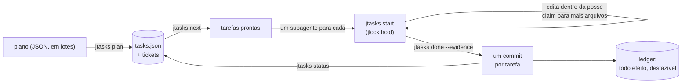

<!-- languages -->
[English](README.md) · [Português (Brasil)](README.pt-BR.md) · [Español](README.es.md) · [Français](README.fr.md) · [Deutsch](README.de.md) · [Italiano](README.it.md) · [简体中文](README.zh-CN.md) · [日本語](README.ja.md) · [Русский](README.ru.md) · [العربية](README.ar.md) · [हिन्दी](README.hi.md)

# jtasks

**O jtasks transforma um plano numa lista de tarefas que agentes de IA de programação executam em paralelo, no
mesmo checkout, sem pisar um no outro, com um commit por tarefa e tudo podendo ser desfeito.**

## Por que o jtasks existe

Agentes de IA de programação conseguem trabalhar em paralelo, mas um objetivo longo ("faça o login", "porte o
parser") dá errado de jeitos conhecidos. O modelo guarda a lista de tarefas na cabeça ou num arquivo Markdown que
edita à mão, e a lista se descola da realidade: uma tarefa é marcada como feita sem estar, dois subagentes pegam a
mesma tarefa, uma dependência é esquecida. Agentes rodando ao mesmo tempo editam o mesmo arquivo e um sobrescreve o
outro. Os commits misturam o trabalho de várias tarefas, e nenhuma pode ser revertida sozinha. E quando uma sessão
morre, ninguém sabe qual tarefa ficou pela metade.

O jtasks tira tudo isso do modelo e põe numa ferramenta. O plano é validado uma vez; a lista vive num arquivo
JSON que só a ferramenta escreve; cada tarefa declara os arquivos que são seus (a posse), e esses arquivos ficam
travados enquanto ela roda.

## O problema, com precisão

- **O que pode rodar agora.** Uma tarefa está pronta quando suas dependências estão feitas e seus arquivos estão
  livres. Duas tarefas sem dependência entre si não podem dividir um arquivo: a ferramenta recusa um plano assim e
  diz quais tarefas e qual arquivo.
- **Quem muda o quê.** Enquanto uma tarefa roda, seus arquivos ficam presos como travas no
  [jlock](https://github.com/rodrigojager/jlock), uma ferramenta de travas para a máquina inteira. Outra tarefa que
  precise de um deles espera na fila (`claim`) ou faz outra coisa; uma espera que fecharia um ciclo é recusada.
- **Prova, não promessa.** Uma tarefa termina com `done` e sua evidência; a ferramenta confere que só os arquivos
  dela mudaram e faz o commit (`T04: título`). Um commit por tarefa: reverter uma tarefa é reverter um commit.
- **Retomar.** Em que ponto a execução está é o estado da lista, não a memória do modelo: `jtasks resume` em
  qualquer janela mostra o que está feito, o que roda, o que espera, e devolve as tarefas de um agente que morreu.
- **Desfazer.** Branches, commits, pastas, linhas em `.git/info/exclude`: todo efeito que a ferramenta deixa está
  num ledger, junto com o modo de desfazê-lo (`jtasks ledger`, `jtasks undo`).

## Como funciona



A ferramenta tem três formas com os mesmos comandos: um mod para o Claude Code (uma ferramenta `jtasks`, um painel
com a checklist e uma barra de progresso, `/jtasks`), um plugin para o OpenCode (a mesma ferramenta e uma seção na
barra lateral) e um CLI, `jtasks`, para um terminal ou qualquer outro agente. Enquanto uma execução está ligada a
uma sessão, o mod e o plugin põem o protocolo no prompt do modelo: `jtasks next`, um subagente por tarefa pronta,
`jtasks status` até não restar nada. Uma guarda recusa edições fora da posse da tarefa e comandos git vindos de
subagentes.

## Instalação

Você precisa do [bun](https://bun.sh) e do `git`. A partir de um clone deste repositório:

```
bun install
bun link            # um comando `jtasks` (ou rode bun cli/jtasks.ts <ação>)
jtasks doctor        # esta máquina está pronta?
jtasks doctor --fix --yes   # instala o que falta: jlock, os agentes do OpenCode, as skills
```

`jtasks doctor --fix` sem `--yes` só lista o que faria. Tudo o que ele instala vai para o ledger, então `jtasks undo`
remove. Depois, para o seu agente:

- **Claude Code:** `claude --plugin-dir <jtasks>/claude` (o mod; veja [`claude/README.md`](claude/README.md)).
- **OpenCode:** acrescente `<jtasks>/opencode` a `plugins` no `opencode.json` (veja
  [`opencode/README.md`](opencode/README.md)).
- **Codex ou um terminal:** as skills em [`skills/`](skills/README.md) ensinam os comandos ao agente.

## Cinco minutos

Um plano com três tarefas: duas que podem rodar juntas e uma que junta as duas.

```json
{
  "objective": "A sum, its docs, and the entry point",
  "tasks": [
    { "id": "T01", "title": "Sum", "files": ["src/sum.ts"], "acceptance": ["sum.ts exports sum"] },
    { "id": "T02", "title": "Docs", "files": ["docs/sum.md"] },
    { "id": "T03", "title": "Entry", "dependsOn": ["T01", "T02"], "files": ["src/index.ts"] }
  ]
}
```

<!-- jtasks-example -->
```text
$ jtasks plan @plan.json
execução a-sum-its-docs-and-the-e-261024-c0oa criada: 3 tarefa(s), branch gt/a-sum-its-docs-and-the-e-261024-c0oa
tickets: 3 em ~/project/.scratch/jtasks/runs/a-sum-its-docs-and-the-e-261024-c0oa/tickets
próximo passo: jtasks next

$ jtasks next
prontas (2) em a-sum-its-docs-and-the-e-261024-c0oa; podem rodar em paralelo:
T01 · Sum · perfil execute · posse: src/sum.ts
  critérios: sum.ts exports sum
  ticket: ~/project/.scratch/jtasks/runs/a-sum-its-docs-and-the-e-261024-c0oa/tickets/01-sum.md
T02 · Docs · perfil execute · posse: docs/sum.md
  ticket: ~/project/.scratch/jtasks/runs/a-sum-its-docs-and-the-e-261024-c0oa/tickets/02-docs.md
bloqueadas: T03 ⛔ T01, T02

$ jtasks start T01
T01 em andamento (tentativa 1): posse travada no jlock (1 chave(s), dono gt:a-sum-its-docs-and-the-e-261024-c0oa/T01)
ticket: ~/project/.scratch/jtasks/runs/a-sum-its-docs-and-the-e-261024-c0oa/tickets/01-sum.md
outro arquivo: jtasks claim T01 <arquivo>; no fim: jtasks done T01 --evidence "…" (ou jtasks fail T01 --error "…")

$ echo "export const sum = (a: number, b: number) => a + b" > src/sum.ts
$ jtasks done T01 --evidence "sum.ts exports sum"
T01 feita: commit 912bebe (T01: Sum); posse devolvida
feitas 1/3 (33%) · restam 2

$ jtasks status
feitas 1/3 (33%) · restam 2
prontas: T02
bloqueadas: T03 ⛔ T02
travas ativas: nenhuma
```

`jtasks next` devolveu T01 e T02 juntas: seus arquivos não se sobrepõem, então dois agentes podem pegá-las ao mesmo
tempo. T03 espera as duas. O `done` fez o commit `T01: Sum` só com `src/sum.ts`.

## Com o Claude Code

Com o mod carregado, peça ao Claude que planeje com a skill `to-tickets` (ela vem junto com o mod): ela divide o
trabalho em tarefas, pede a sua aprovação e entrega o plano à ferramenta em lotes. Depois, comece um goal:

```
/goal toda tarefa da execução <run> está feita ou pulada (jtasks status diz que não resta nada)
```

O Claude chama `jtasks next`, abre um subagente por tarefa pronta na mesma resposta (cada um no modelo do seu
perfil) e chama `jtasks status` até não restar nada. `/jtasks` abre ou fecha o painel.

## Com o OpenCode

Com o plugin, é igual: `to-tickets` para planejar, depois um goal. A chamada `subagent` de cada tarefa recebe o
agente do seu perfil (`execute`, `execute-deep`, `review`, instalados por `jtasks doctor --fix --yes`, ou
qualquer agente que você nomear no plano). A barra lateral mostra a checklist e a barra de progresso.

## De um terminal ou do Codex

Sem mod nem plugin, a skill `jtasks` é o protocolo: o agente roda `jtasks next`, faz cada tarefa dentro da sua
posse (`jtasks start`, `jtasks claim`, `jtasks done`) e repete até `jtasks status` dizer que não resta nada. Uma pessoa
pode fazer o mesmo à mão.

## Garantias e limites

| O jtasks garante | Ele não |
|---|---|
| Só a ferramenta escreve a lista; toda mudança é validada e atômica | impede um programa que ignora o jlock de editar um arquivo |
| Os arquivos de uma tarefa ficam travados no jlock enquanto ela roda; tarefas em paralelo nunca dividem um arquivo | trava partes de um arquivo: a posse é por arquivo e pasta |
| Um commit por tarefa, só com os arquivos dessa tarefa | integra trabalho feito fora da ferramenta |
| Todo efeito está no ledger e pode ser desfeito | desfaz o que não criou |
| As travas de um agente ou janela que morreu voltam (na hora com o OpenCode, no prazo limite nos outros casos) | funciona entre máquinas (o jlock vale para uma máquina) |

Windows primeiro: o jlock e o jtasks foram validados no Windows; Linux e macOS seguem o plano do próprio jlock.

## Configuração

| Variável | Padrão | Uso |
|---|---|---|
| `JTASKS_HOME` | `~/.jtasks` | o ledger global e as execuções arquivadas |
| `JTASKS_LANG` | o do sistema | o idioma das respostas (`--lang` num comando tem prioridade) |
| `JTASKS_RUN` | não definida | a execução em que o CLI trabalha, em vez de `--run` |
| `JLOCK_BIN` | `jlock` | o executável do jlock |

Onze idiomas, os mesmos do jlock: English, Português (Brasil), Español, Français, Deutsch, Italiano, 简体中文,
日本語, Русский, العربية, हिन्दी. Todos os comandos estão em [`docs/USAGE.md`](docs/USAGE.md); o projeto (em
português) está em [`docs/PLAN.md`](docs/PLAN.md), e o que saiu diferente está em
[`docs/DEVIATIONS.md`](docs/DEVIATIONS.md).

## Como contribuir

Issues e pull requests são bem-vindos; veja [`CONTRIBUTING.md`](CONTRIBUTING.md). Revisões dos textos são
bem-vindas em qualquer idioma, inclusive o inglês, e não exigem TypeScript: os textos são arquivos JSON em
`locales/`.

## Autor

Rodrigo Jäger — GitHub <https://github.com/rodrigojager> · LinkedIn <https://www.linkedin.com/in/rodrigojager>

## Licença

MIT, veja [`LICENSE`](LICENSE).
