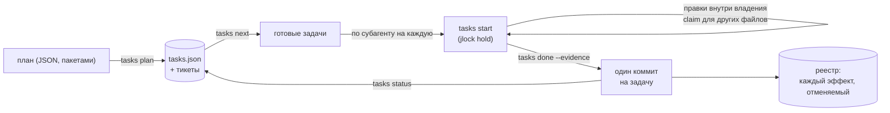

<!-- languages -->
[English](README.md) · [Português (Brasil)](README.pt-BR.md) · [Español](README.es.md) · [Français](README.fr.md) · [Deutsch](README.de.md) · [Italiano](README.it.md) · [简体中文](README.zh-CN.md) · [日本語](README.ja.md) · [Русский](README.ru.md) · [العربية](README.ar.md) · [हिन्दी](README.hi.md)

# jtasks

**jtasks превращает план в список задач, которые ИИ-агенты для программирования выполняют параллельно, в одном
checkout, не мешая друг другу, с одним коммитом на задачу и возможностью всё отменить.**

## Зачем нужен jtasks

ИИ-агенты для программирования умеют работать параллельно, но длинная цель («сделай вход в систему», «перенеси
парсер») ломается знакомыми способами. Модель держит список задач в голове или в Markdown-файле, который правит
вручную, и список расходится с реальностью: задачу отмечают выполненной, хотя это не так, два субагента берут одну
и ту же задачу, зависимость забыта. Агенты, работающие одновременно, правят один и тот же файл, и один затирает
другого. Коммиты смешивают работу нескольких задач, поэтому одну из них нельзя откатить отдельно. А когда сессия
падает, никто не знает, какая задача была сделана наполовину.

jtasks выносит всё это из модели в инструмент. План проверяется один раз; список хранится в JSON-файле, который
пишет только инструмент; каждая задача объявляет файлы, которыми владеет, и эти файлы заблокированы, пока она в
работе.

## Проблема, точнее

- **Что можно запускать сейчас.** Задача готова, когда её зависимости выполнены, а файлы свободны. Две задачи без
  зависимости между ними не должны делить файл: инструмент отклоняет такой план и говорит, какие задачи и какой
  файл.
- **Кто что меняет.** Пока задача в работе, её файлы удерживаются как блокировки в
  [jlock](https://github.com/rodrigojager/jlock) — инструменте блокировок на уровне всей машины. Другая задача,
  которой нужен один из них, ждёт в очереди (`claim`) или делает что-то другое; ожидание, которое замкнуло бы цикл,
  отклоняется.
- **Доказательства, а не обещания.** Задача завершается командой `done` с доказательством; инструмент проверяет,
  что изменились только её файлы, и делает коммит (`T04: название`). Один коммит на задачу: откатить задачу —
  значит откатить один коммит.
- **Возобновление.** Где находится прогон, определяет состояние списка, а не память модели: `tasks resume` в любом
  окне показывает, что выполнено, что в работе, что ждёт, и возвращает задачи умершего агента.
- **Отмена.** Ветки, коммиты, папки, строки в `.git/info/exclude`: каждый эффект, который оставляет инструмент,
  записан в реестр вместе со способом его отменить (`tasks ledger`, `tasks undo`).

## Как это работает



У инструмента три формы с одними и теми же командами: мод для Claude Code (инструмент `tasks`, панель с чек-листом
и индикатором прогресса, `/jtasks`), плагин для OpenCode (тот же инструмент и раздел в боковой панели) и CLI
`tasks` для терминала или любого другого агента. Пока прогон привязан к сессии, мод и плагин добавляют протокол в
промпт модели: `tasks next`, по субагенту на каждую готовую задачу, `tasks status`, пока ничего не останется.
Защита отклоняет правки вне владения задачи и команды git от субагентов.

## Установка

Нужны [bun](https://bun.sh) и `git`. Из клона этого репозитория:

```
bun install
bun link            # команда `tasks` (или запускайте bun cli/tasks.ts <действие>)
tasks doctor        # готова ли эта машина?
tasks doctor --fix --yes   # устанавливает недостающее: jlock, агентов OpenCode, навыки
```

`tasks doctor --fix` без `--yes` только перечисляет, что он сделал бы. Всё, что он устанавливает, попадает в
реестр, так что `tasks undo` это удаляет. Затем, для вашего агента:

- **Claude Code:** `claude --plugin-dir <jtasks>/claude` (мод; см. [`claude/README.md`](claude/README.md)).
- **OpenCode:** добавьте `<jtasks>/opencode` в `plugins` в `opencode.json` (см.
  [`opencode/README.md`](opencode/README.md)).
- **Codex или терминал:** навыки в [`skills/`](skills/README.md) обучают агента командам.

## Пять минут

План из трёх задач: две могут идти одновременно, а третья объединяет их.

```json
{
  "objective": "A sum, its docs, and the entry point",
  "tasks": [
    { "id": "T01", "title": "Sum", "files": ["src/sum.ts"], "acceptance": ["sum.ts exports sum"] },
    { "id": "T02", "title": "Docs", "files": ["docs/sum.md"] },
    { "id": "T03", "title": "Entry", "dependsOn": ["T01", "T02"], "files": ["src/index.ts"] }
  ]
}
```

<!-- jtasks-example -->
```text
$ tasks plan @plan.json
прогон a-sum-its-docs-and-the-e-261024-cryc создан, задач: 3, branch gt/a-sum-its-docs-and-the-e-261024-cryc
тикеты: 3 в ~/project/.scratch/jtasks/runs/a-sum-its-docs-and-the-e-261024-cryc/tickets
следующий шаг: tasks next

$ tasks next
готовы (2) в a-sum-its-docs-and-the-e-261024-cryc; можно выполнять параллельно:
T01 · Sum · профиль implement · владение: src/sum.ts
  критерии: sum.ts exports sum
  ticket: ~/project/.scratch/jtasks/runs/a-sum-its-docs-and-the-e-261024-cryc/tickets/01-sum.md
T02 · Docs · профиль implement · владение: docs/sum.md
  ticket: ~/project/.scratch/jtasks/runs/a-sum-its-docs-and-the-e-261024-cryc/tickets/02-docs.md
заблокированы: T03 ⛔ T01, T02

$ tasks start T01
T01 в работе (попытка 1): владение заблокировано в jlock (ключей: 1, владелец gt:a-sum-its-docs-and-the-e-261024-cryc/T01)
ticket: ~/project/.scratch/jtasks/runs/a-sum-its-docs-and-the-e-261024-cryc/tickets/01-sum.md
другой файл: tasks claim T01 <файл>; в конце: tasks done T01 --evidence "…" (или tasks fail T01 --error "…")

$ echo "export const sum = (a: number, b: number) => a + b" > src/sum.ts
$ tasks done T01 --evidence "sum.ts exports sum"
T01 выполнена: commit 9d9a342 (T01: Sum); владение возвращено
выполнено 1/3 (33%) · осталось: 2

$ tasks status
выполнено 1/3 (33%) · осталось: 2
готовы: T02
заблокированы: T03 ⛔ T02
активные блокировки: нет
```

`tasks next` вернул T01 и T02 вместе: их файлы не пересекаются, поэтому два агента могут взять их одновременно. T03
ждёт обе. `done` сделал коммит `T01: Sum`, в который попал только `src/sum.ts`.

## С Claude Code

Когда мод загружен, попросите Claude спланировать работу с навыком `to-tickets` (он идёт вместе с модом): он
разбивает работу на задачи, просит вас их одобрить и передаёт план инструменту пакетами. Затем запустите цель:

```
/goal каждая задача прогона <run> выполнена или пропущена (tasks status говорит, что ничего не осталось)
```

Claude вызывает `tasks next`, открывает по субагенту на каждую готовую задачу в одном и том же ответе (каждый на
модели своего профиля) и вызывает `tasks status`, пока ничего не останется. `/jtasks` открывает или закрывает
панель.

## С OpenCode

С плагином всё так же: `to-tickets`, чтобы спланировать, затем цель. Вызов `subagent` каждой задачи получает агента
её профиля (`implement`, `implement-deep`, `review`, которых устанавливает `tasks doctor --fix --yes`, или любого
агента, указанного вами в плане). Боковая панель показывает чек-лист и индикатор прогресса.

## Из терминала или Codex

Без мода и плагина протоколом служит навык `jtasks`: агент выполняет `tasks next`, делает каждую задачу в
пределах её владения (`tasks start`, `tasks claim`, `tasks done`) и повторяет, пока `tasks status` не скажет, что
ничего не осталось. Человек может делать то же самое вручную.

## Гарантии и ограничения

| jtasks гарантирует | Чего он не делает |
|---|---|
| Список пишет только инструмент; каждое изменение проверяется и атомарно | не мешает программе, игнорирующей jlock, править файл |
| Файлы задачи заблокированы в jlock, пока она в работе; параллельные задачи никогда не делят файл | не блокирует части файла: владение — по файлам и папкам |
| Один коммит на задачу, только с файлами этой задачи | не сливает работу, сделанную в обход инструмента |
| Каждый эффект есть в реестре, и его можно отменить | не отменяет то, чего он не создавал |
| Блокировки умершего агента или окна возвращаются (сразу с OpenCode, иначе по истечении срока) | не работает между машинами (jlock — это одна машина) |

Сначала Windows: jlock и jtasks проверены на Windows; Linux и macOS следуют собственному плану jlock.

## Настройка

| Переменная | По умолчанию | Назначение |
|---|---|---|
| `JTASKS_HOME` | `~/.jtasks` | глобальный реестр и заархивированные прогоны |
| `JTASKS_LANG` | язык системы | язык ответов (`--lang` у команды важнее) |
| `JTASKS_RUN` | не задана | прогон, с которым работает CLI, вместо `--run` |
| `JLOCK_BIN` | `jlock` | исполняемый файл jlock |

Одиннадцать языков, те же, что у jlock: English, Português (Brasil), Español, Français, Deutsch, Italiano, 简体中文,
日本語, Русский, العربية, हिन्दी. Все команды описаны в [`docs/USAGE.md`](docs/USAGE.md); проект (на португальском) —
[`docs/PLAN.md`](docs/PLAN.md), а то, что получилось иначе, — в [`docs/DEVIATIONS.md`](docs/DEVIATIONS.md).

## Участие

Issues и pull requests приветствуются; см. [`CONTRIBUTING.md`](CONTRIBUTING.md). Правки текстов приветствуются на
любом языке, включая английский, и не требуют TypeScript: тексты — это JSON-файлы в `locales/`.

## Автор

Rodrigo Jäger — GitHub <https://github.com/rodrigojager> · LinkedIn <https://www.linkedin.com/in/rodrigojager>

## Лицензия

MIT, см. [`LICENSE`](LICENSE).

Этот перевод ждёт проверки носителем языка; исправления приветствуются ([как помочь](CONTRIBUTING.md)).
