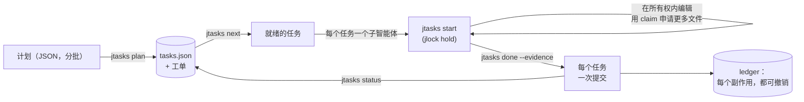

<!-- languages -->
[English](README.md) · [Português (Brasil)](README.pt-BR.md) · [Español](README.es.md) · [Français](README.fr.md) · [Deutsch](README.de.md) · [Italiano](README.it.md) · [简体中文](README.zh-CN.md) · [日本語](README.ja.md) · [Русский](README.ru.md) · [العربية](README.ar.md) · [हिन्दी](README.hi.md)

# jtasks

**jtasks 把一份计划变成一个任务列表，由 AI 编程智能体在同一个检出目录中并行执行，互不干扰，每个任务一次提交，一切都可以撤销。**

## 为什么需要 jtasks

AI 编程智能体可以并行工作，但一个长目标（"实现登录"、"移植解析器"）往往会以熟悉的方式出错。模型把任务列表记在脑子里，或者记在一个手动编辑的 Markdown 文件里，于是列表逐渐走样：没完成的任务被标记为完成，两个子智能体领了同一个任务，某个依赖被遗忘。同时运行的智能体编辑同一个文件，一个覆盖了另一个。提交混杂了多个任务的工作，于是无法单独还原其中一个。而当会话中断时，没人知道哪个任务做到了一半。

jtasks 把这一切从模型中移出来，交给一个工具。计划只校验一次；列表保存在一个只有工具才会写入的 JSON 文件中；每个任务声明它拥有的文件，这些文件在任务运行期间被锁定。

## 问题的准确描述

- **现在可以运行什么。** 当一个任务的依赖都已完成、它的文件都空闲时，它就是就绪的。彼此之间没有依赖的两个任务不能共享文件：工具会拒绝这样的计划，并指出是哪些任务、哪个文件。
- **谁修改什么。** 任务运行期间，它的文件作为锁保存在 [jlock](https://github.com/rodrigojager/jlock) 中，这是一个全机范围的锁工具。需要其中某个文件的另一个任务会排队等待（`claim`），或者先做别的事；会形成等待环的等待会被拒绝。
- **要证据，不要承诺。** 任务用 `done` 和它的证据来结束；工具检查是否只有它的文件被修改，然后提交（`T04: 标题`）。每个任务一次提交：还原一个任务就是还原一次提交。
- **恢复。** 运行进行到哪里，看的是列表的状态，而不是模型的记忆：在任何窗口中运行 `jtasks resume`，都会显示哪些已完成、哪些在进行、哪些在等待，并收回已中断的智能体手中的任务。
- **撤销。** 分支、提交、文件夹、`.git/info/exclude` 中的行：工具留下的每个副作用都记录在 ledger 中，并附有撤销方法（`jtasks ledger`、`jtasks undo`）。

## 工作原理



这个工具有三种形式，命令相同：Claude Code 的 mod（一个 `jtasks` 工具、一个显示清单和进度条的面板，以及 `/jtasks`），OpenCode 的插件（同样的工具，加上侧边栏中的一个区块），以及一个 CLI `jtasks`，供终端或任何其他智能体使用。当某个运行绑定到会话时，mod 和插件会把协议放进模型的提示词：`jtasks next`，每个就绪任务一个子智能体，然后反复 `jtasks status`，直到没有剩余。一个守卫会拒绝任务所有权之外的编辑，以及子智能体发出的 git 命令。

## 安装

你需要 [bun](https://bun.sh) 和 `git`。在本仓库的克隆中：

```
bun install
bun link            # 一个 `jtasks` 命令（或运行 bun cli/jtasks.ts <action>）
jtasks doctor        # 这台机器准备好了吗？
jtasks doctor --fix --yes   # 安装缺少的部分：jlock、OpenCode 智能体、skill
```

不带 `--yes` 的 `jtasks doctor --fix` 只列出它将要做的事。它安装的一切都会记入 ledger，因此 `jtasks undo` 可以把它们移除。然后，根据你的智能体：

- **Claude Code：** `claude --plugin-dir <jtasks>/claude`（mod；见 [`claude/README.md`](claude/README.md)）。
- **OpenCode：** 在 `opencode.json` 的 `plugins` 中加入 `<jtasks>/opencode`（见 [`opencode/README.md`](opencode/README.md)）。
- **Codex 或终端：** [`skills/`](skills/README.md) 中的 skill 会教智能体使用这些命令。

## 五分钟上手

一个包含三个任务的计划：两个可以同时运行，第三个把它们合在一起。

```json
{
  "objective": "A sum, its docs, and the entry point",
  "tasks": [
    { "id": "T01", "title": "Sum", "files": ["src/sum.ts"], "acceptance": ["sum.ts exports sum"] },
    { "id": "T02", "title": "Docs", "files": ["docs/sum.md"] },
    { "id": "T03", "title": "Entry", "dependsOn": ["T01", "T02"], "files": ["src/index.ts"] }
  ]
}
```

<!-- jtasks-example -->
```text
$ jtasks plan @plan.json
运行 a-sum-its-docs-and-the-e-261024-fls1 已创建：3 个任务，branch gt/a-sum-its-docs-and-the-e-261024-fls1
工单：3 个，位于 ~/project/.scratch/jtasks/runs/a-sum-its-docs-and-the-e-261024-fls1/tickets
下一步：jtasks next

$ jtasks next
a-sum-its-docs-and-the-e-261024-fls1 中就绪（2）；可以并行执行：
T01 · Sum · 配置 implement · 所有权：src/sum.ts
  验收标准：sum.ts exports sum
  ticket: ~/project/.scratch/jtasks/runs/a-sum-its-docs-and-the-e-261024-fls1/tickets/01-sum.md
T02 · Docs · 配置 implement · 所有权：docs/sum.md
  ticket: ~/project/.scratch/jtasks/runs/a-sum-its-docs-and-the-e-261024-fls1/tickets/02-docs.md
被阻塞：T03 ⛔ T01, T02

$ jtasks start T01
T01 进行中（第 1 次尝试）：所有权已在 jlock 中锁定（1 个键，所有者 gt:a-sum-its-docs-and-the-e-261024-fls1/T01）
ticket: ~/project/.scratch/jtasks/runs/a-sum-its-docs-and-the-e-261024-fls1/tickets/01-sum.md
需要其他文件：jtasks claim T01 <文件>；结束时：jtasks done T01 --evidence "…"（或 jtasks fail T01 --error "…"）

$ echo "export const sum = (a: number, b: number) => a + b" > src/sum.ts
$ jtasks done T01 --evidence "sum.ts exports sum"
T01 已完成：commit 8b0238f (T01: Sum)；所有权已归还
完成 1/3（33%） · 剩余 2

$ jtasks status
完成 1/3（33%） · 剩余 2
就绪：T02
被阻塞：T03 ⛔ T02
活动的锁：无
```

`jtasks next` 同时返回了 T01 和 T02：它们的文件没有重叠，所以两个智能体可以同时领取。T03 等待两者完成。`done` 生成了提交 `T01: Sum`，其中只包含 `src/sum.ts`。

## 配合 Claude Code

加载 mod 后，让 Claude 用 `to-tickets` skill 来做计划（它随 mod 一起提供）：它会把工作拆分成任务，请你批准，然后分批把计划交给工具。接着启动一个目标：

```
/goal 运行 <run> 的每个任务都已完成或跳过（jtasks status 显示没有剩余）
```

Claude 调用 `jtasks next`，在同一个回复中为每个就绪任务打开一个子智能体（每个都使用其配置对应的模型），并反复调用 `jtasks status`，直到没有剩余。`/jtasks` 打开或关闭面板。

## 配合 OpenCode

使用插件时也一样：用 `to-tickets` 做计划，然后设定一个目标。每个任务的 `subagent` 调用会得到其配置对应的智能体（`implement`、`implement-deep`、`review`，由 `jtasks doctor --fix --yes` 安装，或者是你在计划中指定的任意智能体）。侧边栏显示清单和进度条。

## 在终端或 Codex 中

没有 mod 或插件时，`jtasks` skill 就是协议：智能体运行 `jtasks next`，在所有权内完成每个任务（`jtasks start`、`jtasks claim`、`jtasks done`），并重复，直到 `jtasks status` 显示没有剩余。人也可以手动做同样的事。

## 保证与限制

| jtasks 保证 | 它不会 |
|---|---|
| 只有工具写入列表；每次修改都经过校验且是原子的 | 阻止一个无视 jlock 的程序编辑文件 |
| 任务运行期间，它的文件在 jlock 中被锁定；并行的任务从不共享文件 | 锁定文件的一部分：所有权以文件和文件夹为单位 |
| 每个任务一次提交，只包含该任务的文件 | 合并在工具之外完成的工作 |
| 每个副作用都在 ledger 中，并且可以撤销 | 撤销不是它创建的东西 |
| 已中断的智能体或窗口的锁会被收回（OpenCode 立即收回，其他情况在时限到达时） | 跨机器工作（jlock 只管一台机器） |

Windows 优先：jlock 和 jtasks 已在 Windows 上验证；Linux 和 macOS 跟随 jlock 自身的计划。

## 配置

| 变量 | 默认值 | 用途 |
|---|---|---|
| `JTASKS_HOME` | `~/.jtasks` | 全局 ledger 和已归档的运行 |
| `JTASKS_LANG` | 系统语言 | 回答的语言（命令中的 `--lang` 优先） |
| `JTASKS_RUN` | 未设置 | CLI 操作的运行，代替 `--run` |
| `JLOCK_BIN` | `jlock` | jlock 可执行文件 |

十一种语言，与 jlock 相同：English、Português (Brasil)、Español、Français、Deutsch、Italiano、简体中文、日本語、Русский、العربية、हिन्दी。所有命令见 [`docs/USAGE.md`](docs/USAGE.md)；设计文档（葡萄牙语）是 [`docs/PLAN.md`](docs/PLAN.md)，与设计不同的地方见 [`docs/DEVIATIONS.md`](docs/DEVIATIONS.md)。

## 参与贡献

欢迎提交 issue 和 pull request；见 [`CONTRIBUTING.md`](CONTRIBUTING.md)。欢迎用任何语言（包括英语）审阅文本，不需要会 TypeScript：文本都是 `locales/` 中的 JSON 文件。

## 作者

Rodrigo Jäger — GitHub <https://github.com/rodrigojager> · LinkedIn <https://www.linkedin.com/in/rodrigojager>

## 许可证

MIT，见 [`LICENSE`](LICENSE)。

本译文尚待以中文为母语的人审阅，欢迎指正（见 [CONTRIBUTING.md](CONTRIBUTING.md)）。
